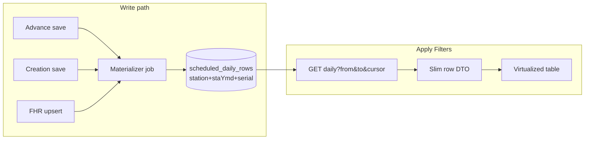

# Scheduled Airlines — complete architecture & performance audit

**Date:** 2026-07-24  
**Scope:** Client **Apply Filters** → `GET /scheduled-airline-pipeline/daily-from-advance` → Nest JSON response (plus parallel client RAF merge).  
**Goal:** Cut CPU, RAM, Mongo I/O, network, serialization, and event-loop blocking so the path can scale toward millions of flight records.  
**Register:** Summarized in `SERVER_ISSUES_AND_REMEDIATION.md` §61 / §60.1 / §26.

**Code verified** (static). Absolute P99 / heap / Atlas bytes = **runtime unverified** (needs `FHR_PERF_TIMERS=1`, `FHR_EXPLAIN_MERGE=1`, k6, APM).

---

## Notation

| Symbol | Meaning |
|--------|---------|
| **F** | Lean FHR docs returned for STA window (before station filter) |
| **Fs** | Station-scoped FHR docs |
| **A** | `advance_schedule_setup` masters for station |
| **C** | `scheduled_airlines_creation` docs for station |
| **D** | Validity-window days per advance master |
| **R** | Temporary daily rows in `out[]` before filter |
| **Rf** | Rows after `_inRequestedRange` filter |
| **U** | Unique serial strings used for NAV / index lookups |
| **S** | FHR docs with six-digit `scheduleId` (supplement scan) |
| **M** | Advance masters matching `dailySyncSource` (time overlay) |

---

## SECTION 1 — Complete request flow

```mermaid
sequenceDiagram
  participant UI as ScheduledAirlinesScreen
  participant API as client/lib/api.ts
  proxy as Next /api-backend
  participant Nest as NestJS
  participant Ctrl as ScheduledAirlinePipelineController
  participant Svc as RawFlightDataService
  participant FHR as FhrCollectionService
  participant Mongo as MongoDB

  UI->>API: fetchDailyScheduledFromAdvance(from,to,{bustCache:true})
  UI->>API: fetchCreationRafByDateRange (parallel)
  API->>proxy: GET .../daily-from-advance?from&to&nocache=1
  proxy->>Nest: forward cookies, cache no-store
  Nest->>Nest: GlobalJwtAuthGuard → RolesGuard → FrisPagePermissionGuard → OperationalThrottler → RequestTimeout(@SkipTimeout)
  Nest->>Ctrl: listDailyFromAdvance
  Ctrl->>Svc: listDailyFromAdvance(from,to,skipCache=true,station)
  Svc->>Svc: parse dates, sweep list-daily cache (read skipped)
  Svc->>Mongo: advance_schedule_setup find (forward-only ids)
  Svc->>FHR: findAllLeanForScheduledTableMerge
  FHR->>FHR: loadStaWindowRowsCached
  alt cache miss
    FHR->>Mongo: fhr_collection find+cursor (staDates $in / legacy)
    FHR->>Mongo: fhr_collection cursor ALL 6-digit scheduleId (supplement)
  end
  FHR-->>Svc: scoped lean rows
  Svc->>Svc: appendFhrCollectionRowsToDaily
  Svc->>Mongo: advance_schedule_setup find ALL station
  Svc->>Svc: appendAdvanceScheduleRowsToDaily (expand days)
  Svc->>Mongo: scheduled_airlines_creation find ALL station
  Svc->>Svc: appendScheduledCreationRowsToDaily (O(C×R) overlay)
  Svc->>Svc: dedupeDailyRowsByScheduleDay
  Svc->>Mongo: flight_instance_index (+ counter insertMany)
  Svc->>Svc: attachStableSerials
  Svc->>Mongo: flight_cancellations find range
  Svc->>Mongo: raw_flight_data find $or serials (NAV)
  Svc->>Svc: finalizeDailyFhrCollectionOnly
  Svc->>Mongo: advance_schedule_setup find again (times)
  Svc->>Svc: applyAdvanceScheduleTimesToDailyRows (+ optional heal writes)
  Svc->>Svc: JSON.stringify bytes + deep-clone into list-daily cache
  Svc-->>Ctrl: Array<{data}>
  Ctrl-->>API: JSON
  API-->>UI: parse + processFlightData + filter + merge RAF
```

### 1.1 Client — Apply Filters

| Item | Detail |
|------|--------|
| **File** | `client/features/fris/flights/scheduled/ScheduledAirlinesScreen.tsx` |
| **Functions** | `handleFilter` → `loadFlightsForYmdRange` |
| **Why** | Operator picks STA window; reload table |
| **Input** | `fromDate` / `toDate` (`yyyy-MM-dd`) |
| **Output** | `setAllFlights(FlightData[])` |
| **Complexity** | O(Rf) client map/filter + O(raf) merge |
| **CPU** | `processFlightData`, `filterFlightsToDateWindow`, `mergeCreationRafIntoScheduledFlights` |
| **RAM** | Full flight array in React state (second copy after transform) |
| **DB** | None directly |

Critical: `bustCache: true` always → query `nocache=1`.

### 1.2 Client API

| Item | Detail |
|------|--------|
| **File** | `client/lib/api.ts` — `fetchDailyScheduledFromAdvance` |
| **Why** | Cookie auth via `/api-backend`; inflight Map dedupe |
| **Input** | `dd/MM/yyyy`, `opts.bustCache` (default **true**) |
| **Output** | `unknown[]` rows |
| **Cost** | `res.text()` then `JSON.parse` — **full payload in string + object** (2× network body in RAM briefly) |

Parallel: `fetchCreationRafByDateRange` (separate Nest path; not expanded here except as extra QPS).

### 1.3 Next.js proxy

| Item | Detail |
|------|--------|
| **File** | `client/app/api-backend/[[...path]]/route.ts` |
| **Why** | Browser must not call Railway directly (Workers rule) |
| **Behavior** | Forward path/query/cookies; `cache: 'no-store'`; buffer body |
| **Cost** | Extra hop + full response buffer on Worker/Node |

### 1.4 Nest bootstrap / guards / interceptors

| Step | File / symbol | Why | Cost |
|------|---------------|-----|------|
| `GlobalJwtAuthGuard` | `common/guards/global-jwt-auth.guard.ts` | Auth | JWT verify O(1) |
| `RolesGuard` | `auth/guards/roles.guard.ts` | Role gate — **no `@Roles` on route → pass** | Negligible |
| `FrisPagePermissionGuard` | `auth/guards/fris-page-permission.guard.ts` | Page gate — **no decorator → pass** | Negligible |
| `OperationalThrottlerGuard` | `protection/guards/operational-throttler.guard.ts` | GLOBAL throttle | Redis/memory counter |
| `RequestTimeoutInterceptor` | `protection/interceptors/request-timeout.interceptor.ts` | Abort long work — **`@SkipTimeout` skips** | Negligible |
| `@CurrentStation` | station decorator | Station scope from JWT | O(1) |
| Validation | Query strings only — **no DTO class** | Loose `from`/`to`/`nocache` | Parse in service |

### 1.5 Controller

| Item | Detail |
|------|--------|
| **File** | `raw-flight-data/controllers/scheduled-airline-pipeline.controller.ts` |
| **Class** | `ScheduledAirlinePipelineController` |
| **Method** | `listDailyFromAdvance` (`@Get('daily-from-advance')`) |
| **Why** | HTTP adapter; maps `nocache` → `skipCache` |
| **Headers** | `Cache-Control: no-store` |
| **Output** | Raw service array (Nest serializes to JSON) |

### 1.6 Service orchestration

| Item | Detail |
|------|--------|
| **File** | `raw-flight-data/services/raw-flight-data.service.ts` |
| **Method** | `listDailyFromAdvance` (~6329–6435) |
| **Pipeline (serial)** | validate → (skip cache read) → forward-only IDs → FHR append → advance append → creation append → dedupe → attach serials → strip temp fields → range filter → finalize → advance times → log bytes → **always write cache clone** → return |

---

## SECTION 2 — Complete call graph

```
ScheduledAirlinesScreen.handleFilter
└─ loadFlightsForYmdRange
   ├─ fetchDailyScheduledFromAdvance ──────────────────────────────┐
   └─ fetchCreationRafByDateRange (parallel, separate tree)        │
                                                                   ▼
frisFetch → /api-backend/scheduled-airline-pipeline/daily-from-advance
└─ ScheduledAirlinePipelineController.listDailyFromAdvance
   └─ RawFlightDataService.listDailyFromAdvance
      ├─ parseDdMmYyyy / dateToYmd
      ├─ sweepListDailyFromAdvanceCache
      ├─ getListDailyFromAdvanceCacheEntry          [SKIPPED when nocache=1]
      ├─ loadForwardOnlyAdvanceScheduleIds
      │  └─ advanceScheduleModel.find(...).lean()
      ├─ appendFhrCollectionRowsToDaily
      │  ├─ dateRangeToDdMmYyyyList
      │  └─ FhrCollectionService.findAllLeanForScheduledTableMerge
      │     ├─ loadStaWindowRowsCached
      │     │  ├─ sweepStaWindowRowsCache
      │     │  ├─ staWindowRowsCache.get / inflight join
      │     │  ├─ [miss] chunkDdMmYyyyStrings?
      │     │  │  └─ fetchDashboardBundleRowsChunk   ⚠ uses DASHBOARD_BUNDLE_PROJECTION
      │     │  │     └─ fhrModel.find(filter).select(...).lean().cursor()
      │     │  │        └─ scheduledMergeFilterForDates / fhrStaDatesRangeFilter
      │     │  ├─ fetchAdvanceScheduleMasterSupplementForStaWindow
      │     │  │  ├─ fhrModel.find({scheduleId: /^\d{6}$/}).lean().cursor()  ⚠ unbounded
      │     │  │  ├─ repairAdvanceMasterStaDatesFromStaging? (async)
      │     │  │  └─ fhrModel.updateOne staDates? (fire-and-forget)
      │     │  └─ dedupeScheduledMergeRows → cache.set
      │     └─ filterRowsByStation
      │  ├─ per FHR doc: date normalize, skip NS, expand STA days → out.push
      │  └─ returns fhrBySerial Map
      ├─ appendAdvanceScheduleRowsToDaily
      │  ├─ advanceScheduleModel.find(station).lean()   ⚠ full station masters
      │  ├─ filter dailySyncSource in Node
      │  ├─ clearScheduleMasterCancelFlags? (possible writes)
      │  └─ enumerateAdvanceOperatingDates → per day out.push
      ├─ appendScheduledCreationRowsToDaily
      │  ├─ scheduledCreationModel.find(station).lean()  ⚠ full station
      │  └─ for each creation × for each out row overlay   ⚠ O(C×R)
      ├─ dedupeDailyRowsByScheduleDay
      │  └─ Maps + filter + out.splice/rebuild
      ├─ attachStableSerials
      │  ├─ flight_instance_index.find({instanceKey:$in})
      │  ├─ allocateSerialBlock → counter findOneAndUpdate
      │  ├─ insertMany new index rows
      │  └─ repair duplicate helpers (find/delete/update)
      ├─ filter _inRequestedRange
      ├─ finalizeDailyFhrCollectionOnly
      │  ├─ (optional) getLeanFhrBySerialsMap — usually skipped (prefetch)
      │  ├─ FlightCancellationsService.getCancelledKeysInRange
      │  │  └─ flight_cancellations.find(range).select().lean()
      │  ├─ loadExportedNavLabelsBySerials
      │  │  └─ raw_flight_data.find({$or: serialMatch×N}).select({data:1}).lean()
      │  └─ map rows: status/locks/bags/cancel/NAV; delete _inRequestedRange
      ├─ applyAdvanceScheduleTimesToDailyRows
      │  ├─ advance_schedule_setup.find(...).sort({updatedAt:-1}).lean()  ⚠ 3rd advance read
      │  ├─ masters.find per row (O(Rf×M))
      │  └─ FhrCollectionService.patchExistingInstanceScheduleTimes? (async multi-collection writes)
      ├─ Buffer.byteLength(JSON.stringify(result))
      ├─ setListDailyFromAdvanceCacheEntry(JSON.parse(JSON.stringify(result)))  ⚠ even if skipCache
      └─ return result
         └─ Nest JSON.stringify response
            └─ client JSON.parse → processFlightData → filter → RAF merge → setState
```

---

## SECTION 3 — Database operations

| # | Collection | Method | Filter / notes | lean | Projection | Index intent | Scan risk | Sort |
|---|------------|--------|----------------|------|------------|-------------|-----------|------|
| 1 | `advance_schedule_setup` | `find` | `StationScope` + `data.dailySyncSource` | yes | `{serialNo:1}` | station + nested field | Moderate if nested unindexed | no |
| 2 | `fhr_collection` | `find`+cursor | `fhrStaDatesRangeFilter` (`staDates $in` OR legacy nested) | yes | **DASHBOARD_BUNDLE** (too wide for this route) | `{staDates:1,SerialNo:1}`, `{stationCode:1,staDates:1,SerialNo:1}` | Indexed `$in` OK; **legacy `$or` branch can examine many docs** | no |
| 3 | `fhr_collection` | `find`+cursor | `scheduleId` exists string `/^\d{6}$/` | yes | scheduled/dashboard fields | scheduleId may lack selective index | **HIGH — near collection scan of masters** | no |
| 4 | `fhr_collection` | `updateOne` | `{SerialNo}` set `staDates` | — | — | SerialNo | Point update (side effect) | — |
| 5 | `advance_schedule_setup` | `find` | station all | yes | `{serialNo,data}` | station | **Full station masters every request** | no |
| 6 | `scheduled_airlines_creation` | `find` | station all | yes | `{serialNo,data}` | station | **Full station creation every request** | no |
| 7 | `flight_instance_index` | `find` | `instanceKey $in` | yes | default | instanceKey unique? | Indexed `$in` | no |
| 8 | counter coll | `findOneAndUpdate` | upsert+inc | — | — | key | Point | — |
| 9 | `flight_instance_index` | `insertMany` | new keys | — | — | — | Write batch | — |
| 10 | `flight_cancellations` | `find` | cancelledDate range + station | yes | instanceSerial, cancelledDate | date+station | Bounded by range | no |
| 11 | `raw_flight_data` | `find` | huge `$or` of serial field variants | yes | `{data:1}` | serial fields uneven | **HIGH — fat $or, weak plan** | no |
| 12 | `advance_schedule_setup` | `find` | dailySyncSource + station | yes | serialNo,data,updatedAt | station | **Duplicate read #3** | `updatedAt:-1` |
| 13+ | heal path | `update`×N | FHR + terminal + load + ramp1 + main_details | — | — | serial | Write amplification on time heal | — |

**Duplicate queries:** advance_schedule_setup read **3×** per miss path (forward-only, expand, times).  
**N+1:** creation overlay is Nest N×R (not Mongo N+1); heal can fan-out updates per matched FHR.  
**Hydration:** all main reads `.lean()` — good.  
**Spill:** large `$in` / `$or` + wide projection → Mongo working set + Node heap (not sort spill).

---

## SECTION 4 — Collection access

| Collection | Why | Times / request (typical Apply Filters) | Repeat? | Join in Node? |
|------------|-----|------------------------------------------|---------|---------------|
| `fhr_collection` | Table truth + supplement + optional heal | 1–N chunk reads + 1 supplement cursor (+ updates) | STA cache may reuse | Yes — expand days, map fields |
| `advance_schedule_setup` | Forward-only set, expand, times | **3 finds** | Yes identical station set | Yes — day expansion |
| `scheduled_airlines_creation` | Overlay / invent rows | 1 full station find | Yes every Apply | Yes — O(C×R) |
| `flight_instance_index` | Stable serials | 1–3 finds + inserts | Per missing keys | — |
| serial counter | Allocate blocks | 0–1 | When new instances | — |
| `flight_cancellations` | Per-day cancel flags | 1 | — | Set join in Node |
| `raw_flight_data` | NAV Yes labels | 1 fat `$or` | — | Map join |
| `terminal_details` / `load_control_details` / `ramp_details_1` / `main_details` | Time heal only | 0–many updates | Side effect | — |

Station filter for FHR is **after** cross-station cache load → other stations’ docs ride in RAM until filtered.

---

## SECTION 5 — CPU analysis

| Function | Complexity | Why CPU grows |
|----------|------------|---------------|
| `loadStaWindowRowsCached` + cursor drain | O(F) + O(S) supplement | Drain + normalize every master |
| Supplement `JSON.stringify` compare staDates | O(S × d log d) | Sort+stringify per master |
| `appendFhrCollectionRowsToDaily` | O(Fs × days_in_range) | Per doc multi-field date parse; multi-alias copies |
| `enumerateAdvanceOperatingDates` | O(A × D) | Walk validity calendars in JS |
| `appendScheduledCreationRowsToDaily` | **O(C × R)** | Nested scan of all daily rows per creation |
| `dedupeDailyRowsByScheduleDay` | O(R) + map | Multi-pass; string keys |
| `attachStableSerials` | O(R log R) sorts | Candidate sort twice |
| `finalizeDaily…` | O(Rf + F) | Field alias writes, cancel set checks |
| `loadExportedNavLabelsBySerials` | O(U × predicates) build + O(docs) | Giant `$or` construction |
| `applyAdvanceScheduleTimes…` | **O(Rf × M × tokens)** worst | `masters.find` inside row loop |
| `JSON.stringify` ×2–3 | O(payload) | bytes log + cache clone + Nest response |
| `JSON.parse` clone | O(payload) | Cache write even when `nocache` |

**Repeated work:** date normalize on same strings; airline/flight key rebuild; duplicate field aliases (`Flight No` / `flightNo` / …) written many times; advance masters loaded thrice; FHR embeds re-read conceptually in finalize though map reused.

---

## SECTION 6 — RAM analysis

| Allocation | Lifetime | Peak impact |
|------------|----------|-------------|
| STA-window cache `rows[]` (up to 12 keys × full lean embeds) | 5 min TTL | **Dominant heap** — includes equipment/manpower/remarks (dashboard projection) |
| Supplement `out[]` during master scan | Request | Extra FHR-sized objects |
| `out[]` daily rows during build | Request | Grows to R then shrinks to Rf |
| `fhrBySerial` Map | Request | Holds Fs references (alias into cache rows — good) |
| Creation/advance full doc arrays | Request | Entire station staging |
| Cache payload deep clone of **result** | 5 min | **Second full table copy** written even on `nocache` |
| `JSON.stringify` temp string | Sync spike | ≈ response size |
| Nest response buffer | Until flush | Third copy |
| Client `text` + `parse` + `processFlightData` + React state | Until next filter | 3–4× client copies |

**Alive across requests:** process-local STA cache + list-daily cache (max 8). Not shared across replicas (§46 / AUD-H08).

---

## SECTION 7 — Event-loop analysis (sync blockers)

| Operation | Blocks? | Notes |
|-----------|---------|-------|
| Cursor `for await` | Yields between docs | Still long if F large |
| Supplement full master walk | Long async but CPU-heavy normalize | Starves other requests on same isolate |
| O(C×R) creation overlay | **Sync nested loops** | Classic event-loop freeze |
| O(Rf×M) time match | Sync | |
| `JSON.stringify(result)` for metrics | Sync | Full payload |
| `JSON.parse(JSON.stringify(result))` cache | Sync | Full deep clone |
| Nest serializer | Sync | Full payload |
| Client `JSON.parse` + `processFlightData` | Main thread | UI jank |

---

## SECTION 8 — Cache analysis

### A. List-daily cache (`list-daily-from-advance-cache.util.ts`)

| Property | Value |
|----------|-------|
| What | Final `Array<{data}>` for table |
| Key | `station|ALL : fromYmd : toYmd` |
| TTL | 5 min |
| Max entries | 8 |
| Footprint | Entire JSON-shaped table per key |
| Invalidation | `invalidateListDailyFromAdvanceCache()` on mutations |
| Hit rate (UI Apply Filters) | **~0%** — client always `nocache=1` |
| Miss behavior | Full rebuild, **then still writes clone** |
| Leak risk | Bounded by max 8; still large objects |
| Replace with | Day-shard Redis / materialized `scheduled_daily_rows` |

### B. STA-window rows cache (`FhrCollectionService`)

| Property | Value |
|----------|-------|
| What | Lean FHR arrays for date window |
| Key | `dd/MM..dd/MM:count` — **no station** |
| TTL | 5 min; max 12; inflight coalescing |
| Footprint | Full embeds × F (dashboard projection) |
| Hit rate | Shared with dashboard — can be high |
| Problem | Cross-station retention; over-wide projection for scheduled list |
| Replace with | Station-aware Redis; column projection; day shards |

### C. Client inflight Map

Dedupes identical in-flight GETs only; not a TTL cache.

---

## SECTION 9 — Data flow (field origins)

Representative client columns (via `processFlightData` / table):

| Field family | Origin collection | Query / stage | Mapper | Copies before client |
|--------------|-------------------|---------------|--------|----------------------|
| Airline, Flight No, Aircraft, Routing | FHR `mainDetails` / advance `data` / creation `data` | FHR merge or advance expand | `append*` object literals | 1–3 (row → finalize mutate → JSON → parse) |
| STA/STD date/time | embeds / advance / overlay | append + `applyAdvanceScheduleTimes` | multiple aliases | Many alias keys on same row |
| SlNo / serialNo / legacySlNo | `flight_instance_index` + FHR SerialNo | `attachStableSerials` | mutate `data` | 2+ |
| flightStatus / locks / bags | FHR embeds | `finalizeDailyFhrCollectionOnly` | mutate | 1–2 |
| isCancelled (day) | `flight_cancellations` + mainDetails flags | finalize | Set lookup | 1 |
| exportedNAV | `raw_flight_data.data` | `loadExportedNavLabelsBySerials` | map | 1 |
| Type of Handling / category | creation/advance/FHR | append + dedupe overlay | aliases | 2+ |
| scheduleSource / scheduleId | synthetic | append | — | 1 |

**Duplicate keys on purpose:** `Flight No` + `flightNo`, `STA Date` + `staDate`, etc. — multiplies JSON size.

---

## SECTION 10 — Merge analysis

| Merge | Inputs | Algorithm | CPU / RAM | Mongo instead? | Offline / materialize? |
|-------|--------|-----------|-----------|----------------|------------------------|
| FHR → daily rows | Fs docs | Per STA day explode | O(Fs×d) | `$unwind` staDates | **Yes — daily shard docs** |
| Advance → daily | A masters | Enumerate operating days | O(A×D) | Precompute calendar instances | **Yes at schedule save** |
| Creation overlay | C × R | Nested match serial+day | **O(C×R)** | `$lookup` by scheduleId+date | Index join table |
| Dedupe natural key | R | Rank FHR > advance | O(R) | Prefer single source of truth | Materialized winner |
| Finalize enrich | Rf + FHR map + cancels + NAV | Map join | O(Rf) | `$lookup` cancel/NAV | Denormalize on write |
| Time overlay | Rf × M | Linear find | O(Rf×M) | Keyed Map / DB lookup | Stamp times at expand |
| Client RAF merge | table + RAF | Client | O(n) | Server include RAF | Single API |

---

## SECTION 11 — Repeated computation

| Repeat | Where | Eliminate |
|--------|-------|-----------|
| Advance masters loaded 3× | forward / expand / times | One load, pass Set+Map |
| Date normalize same strings | FHR/advance/creation | Normalize once at ingest; store YMD |
| Alias field writes | every append | Single canonical DTO; map at edge |
| Deep JSON clone on cache write after nocache | listDaily end | Skip write when `skipCache`; use structuredClone only if needed |
| Bytes `JSON.stringify` | every miss | Sample / estimate length |
| Station filter after global FHR fetch | findAllLean… | Include `stationCode` in Mongo filter |
| Client re-filter date window | already filtered server-side | Drop redundant filter or slim API |
| `nocache=1` every Apply | api.ts default | Soft refresh without bust; ETag |

---

## SECTION 12 — Object lifecycle (one flight)

```
Mongo BSON (fhr_collection)
  → lean JS object (driver)                    // copy 1
  → retained in staWindowRowsCache.rows        // same ref if cache
  → referenced in fhrBySerial Map              // same ref
  → NEW { data: { …aliases } } daily row       // copy 2 (wide)
  → possibly mutated by creation overlay       // same object
  → possibly mutated by dedupe overlay         // same object
  → mutated by attachStableSerials             // same object
  → mutated by finalize (status/NAV/…)         // same object
  → mutated by applyAdvanceScheduleTimes       // same object
  → JSON string (Nest)                         // copy 3
  → client parse object                        // copy 4
  → processFlightData FlightData               // copy 5
  → React state                                // same as 5 or clone
```

**Simultaneous peak:** cache lean + daily `data` + JSON string + (if caching) deep-cloned result ≈ **3–4 full representations** of the window on the server for one Apply Filters.

---

## SECTION 13 — Network cost

| Factor | Assessment |
|--------|------------|
| Response shape | `[{ data: { many aliases + embeds-derived fields } }]` |
| Unused / heavy | equipment/manpower often unused on list; duplicate aliases; internal schedule keys |
| Nested | Flat `data` but many keys |
| Compression | Rely on reverse-proxy gzip; Worker buffers full body |
| Reduction | Column DTO (~15–25 fields); pagination; omit cancelled if toggled off server-side |
| Extra call | Parallel creation-raf doubles chatter |

---

## SECTION 14 — Hot paths (ranked)

### Top CPU consumers
1. `appendScheduledCreationRowsToDaily` O(C×R)  
2. `fetchAdvanceScheduleMasterSupplementForStaWindow` full master walk  
3. `appendAdvanceScheduleRowsToDaily` day expansion  
4. `appendFhrCollectionRowsToDaily` field/date work  
5. `JSON.stringify` / `parse` clone  
6. `applyAdvanceScheduleTimesToDailyRows` O(Rf×M)  
7. `dedupeDailyRowsByScheduleDay`  
8. `attachStableSerials` sorts  
9. `finalizeDailyFhrCollectionOnly`  
10. Nest response serialize  
11. Client `processFlightData`  
12. Cursor drain FHR chunks  
13. NAV `$or` construction  
14. Station filter copy  
15. Date variant expansion  
16. Alias key assignment  
17. Cancel key set checks  
18. Dedupe overlay loops  
19. Cache sweep scans  
20. Logger / perf byte measure  

### Top RAM consumers
1. STA-window cache (dashboard-wide projection)  
2. Daily `out`/`result` arrays  
3. List-daily cache deep clone  
4. Advance+creation full station loads  
5. Response JSON string  
6. Supplement array  
7. `fhrBySerial` (refs)  
8. Instance index candidate structures  
9. Client text+parse  
10. React `allFlights`  
11–20. Maps/Sets/temps (smaller)

### Top Mongo consumers
1. FHR STA `$in` (+ legacy branch)  
2. FHR six-digit scheduleId cursor  
3. `raw_flight_data` fat `$or`  
4. `advance_schedule_setup` ×3  
5. `scheduled_airlines_creation` full station  
6. `flight_instance_index`  
7. Cancel range  
8. Counter upsert  
9. Heal updates  
10. staDates persist updates  

### Top sync / allocation ops
Deep JSON clone; Nest stringify; creation nested loops; time `masters.find`; object literals per day; array spreads in dedupe; Set/Map churn.

---

## SECTION 15 — Optimization opportunities

| Area | Small | Medium | Large / architecture |
|------|-------|--------|----------------------|
| `nocache` | Default soft cache; bust only on mutation toast | ETag / If-None-Match | Client SWR + Redis |
| Cache write | **Skip `setListDaily…` when skipCache** | Store shared ArrayBuffer | External cache |
| Projection | Use `SCHEDULED_MERGE_PROJECTION` in `loadStaWindowRowsCached` for this path | Split caches by consumer | Columnar day shards |
| Supplement | Filter masters by `staDates $in` in Mongo | Drop regex scan | Maintain master index collection |
| Advance ×3 | Single `loadAdvanceMasters(station)` | | Materialize instances on save |
| Creation O(C×R) | Index `out` by `scheduleMasterSerial|ymd` Map | Mongo `$lookup` | Write-time overlay into daily shard |
| Times O(Rf×M) | `Map` by schedule serial | | Stamp at expand |
| NAV | Store `exportedNAV` on FHR/mainDetails only | Drop raw `$or` | Already partially on FHR — stop raw read |
| Serial attach | Batch only missing; no repair on read path | | Pre-allocate at FHR create |
| Response | Slim DTO; drop aliases | Cursor pagination `?cursor&limit` | Virtualized infinite scroll |
| CPU offload | — | Worker thread for expand/dedupe | Background materializer job |
| Mongo | Hint `staDates_1_SerialNo_1`; station in filter | Remove legacy `$or` after backfill | Aggregations `$facet` |
| Heal writes | Never on GET | Queue async job | — |

**Estimated gains (order-of-magnitude, staging must confirm):**

| Fix | Latency | CPU | RAM | Mongo |
|-----|---------|-----|-----|-------|
| Stop nocache-default + skip useless cache write | 0–80% on warm | med | −1 table copy | −100% on warm hit |
| Correct projection + station in query | 10–30% | low | **−30–60% FHR heap** | −bytes |
| Kill unbound supplement / replace | 20–70% cold | high | high | **huge** |
| Map-index creation overlay | 10–40% | high | low | 0 |
| One advance load | 5–15% | low | −2× masters | −2 finds |
| Materialized daily rows | **50–90%** list | **high** | **high** | reads tiny shards |
| Slim DTO + pagination | network 40–70% | serialize ↓ | ↓ | same or ↓ |

---

## SECTION 16 — Performance scores (/10)

| Component | Score | Rationale |
|-----------|-------|-----------|
| Controller | 6 | Thin; `@SkipTimeout` needed; weak validation/DTO |
| Orchestrator service | 3 | Serial kitchen-sink; cache write vs nocache contradiction |
| Mongo queries | 3 | Indexed STA path OK; supplement + NAV + full staging scans poor |
| Cache design | 2 | UI bypasses list cache; STA cache over-wide & cross-station |
| Merges | 3 | Correct business-wise; algorithmic cost high |
| Serialization | 2 | Alias explosion; triple stringify paths |
| Memory | 2 | Multi full-window copies |
| CPU | 2 | O(C×R), O(Rf×M), JSON clones |
| Event loop safety | 2 | Sync nested loops on large R |
| Overall architecture | 3 | Read-time assembly of what should be write-time instances |
| **Average** | **~2.8 / 10** | Not viable for millions of flights without materialization |

---

## SECTION 17 — Executive report

### Biggest bottlenecks

1. **CPU:** creation×daily nested overlay; advance day expansion; JSON deep clone; time-master linear search.  
2. **RAM:** STA-window cache with dashboard projection; full daily result + cache clone; full station staging loads.  
3. **Mongo:** FHR master supplement regex cursor; fat `raw_flight_data` `$or`; triple `advance_schedule_setup`; unscoped station FHR then filter.  
4. **Event loop:** O(C×R) and large `JSON.stringify`.  
5. **Unnecessary work:** `nocache=1` every Apply yet still cache-write clone; duplicate aliases; third advance query; NAV from raw when FHR may already hold flag.  
6. **Duplicate work:** advance×3; date normalize; client re-filter.  
7. **Architecture:** **Request-time universe assembly** instead of **materialized per-day flight instances**.

### Priority order (highest ROI first)

1. **P0** — Materialize `scheduled_daily_rows` (or reuse FHR instance-per-day) on schedule/FHR write; list = indexed range query + slim projection + pagination.  
2. **P0** — Stop UI `nocache` default **or** honor cache; **never deep-clone write when skipCache**.  
3. **P0** — Replace master supplement collection scan with `staDates`-indexed query (or delete path).  
4. **P1** — Station filter in Mongo; use list projection not dashboard bundle in STA cache path for this consumer.  
5. **P1** — Index creation overlay via Map; single advance load; Map for times.  
6. **P1** — Drop NAV raw scan; slim response DTO; remove alias duplication.  
7. **P2** — Redis shared caches; move heal off GET; worker/queue expand.  
8. **P2** — Client: one API (include RAF), virtualize table, don’t hold unused fields.

### Target architecture (millions of flights)



List path becomes **O(page size)** Mongo + O(page) CPU — not O(station×masters×days×FHR).

---

## Appendix — files touched by this path

| Layer | Path |
|-------|------|
| UI | `client/features/fris/flights/scheduled/ScheduledAirlinesScreen.tsx` |
| Client API | `client/lib/api.ts` (`fetchDailyScheduledFromAdvance`) |
| Proxy | `client/app/api-backend/[[...path]]/route.ts` |
| Controller | `server/src/raw-flight-data/controllers/scheduled-airline-pipeline.controller.ts` |
| Service | `server/src/raw-flight-data/services/raw-flight-data.service.ts` |
| List cache | `server/src/raw-flight-data/utils/list-daily-from-advance-cache.util.ts` |
| FHR | `server/src/fhr-collection/services/fhr-collection.service.ts` |
| STA filter util | `server/src/fhr-collection/utils/sta-dates.util.ts` |
| Cancels | `server/src/flight-cancellations/flight-cancellations.service.ts` |
| Processor | `client/utils/dataProcessor` (`processFlightData`) |

---

*Re-verify with `FHR_PERF_TIMERS=1`, `FHR_EXPLAIN_MERGE=1`, and staging k6 after each remediation. Mirror status into `SERVER_ISSUES_AND_REMEDIATION.md` §61.*
