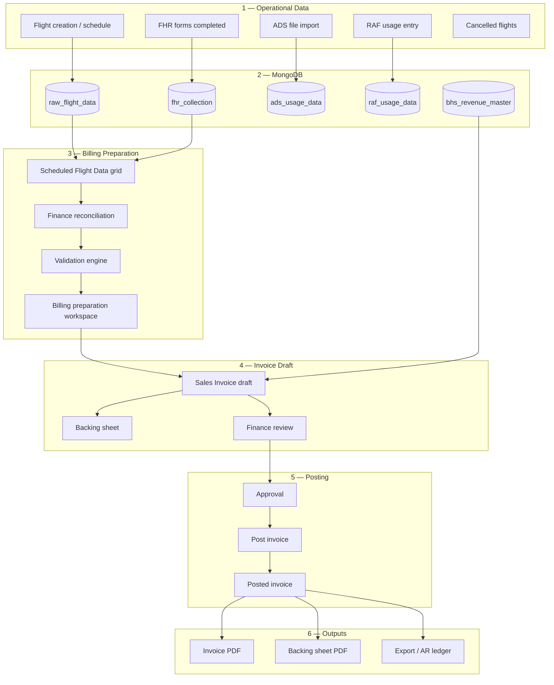

# Audit Discovery Report — Business Central Invoicing (GBASPL)

**Source of truth:** `docs/invoicing/audit/`  
**Audit date:** 2026-06-25  
**BC company:** GBASPL (Globeground India Pvt Ltd)  
**BC environment:** Production  
**Live BC UI:** Not reached during audit (login failure) — entries marked **VERIFY IN BC** require finance/IT confirmation  
**FRIS billing module:** `billing/` (native replacement)

---

## Executive summary

Bird Worldwide Flight Services (BWFS) invoicing today is a **hybrid**: FRIS captures all operational truth in MongoDB; finance reconciles in Excel; Business Central holds legal sales documents and PDFs. The only confirmed FRIS → BC handoff in code is setting `exportedNAV: Yes` on flight serials — not pushing invoice lines. A native FRIS billing system must reproduce the full lifecycle: **ops capture → validation/reconciliation → draft invoice lines → backing detail → post → PDF → AR ledger**.

---

## Business Central pages (complete inventory)

### A. Master data

| ID | Tell Me / Menu | Page title | Screenshot | Evidence |
|----|----------------|------------|------------|----------|
| A1 | `Customers` | Customers | `A01-customers-list.png` | STANDARD + INFERRED |
| A2 | `Items` | Items / service codes | `A02-items-list.png` | INFERRED from FRIS export types |
| A3 | `G/L Accounts` | G/L Accounts | `A03-gl-accounts.png` | STANDARD |
| A4 | `Dimensions` | Dimensions | `A04-dimensions.png` | INFERRED |
| A5 | `Currencies` | Currencies | `A05-currencies.png` | INFERRED |
| A5b | `Currency Exchange Rates` | Exchange rates (ROE) | `A09-exchange-rates.png` | INFERRED |
| A6 | `Payment Terms` | Payment Terms | `A06-payment-terms.png` | STANDARD |
| A7 | `Units of Measure` | UOM | `A07-uom.png` | INFERRED |
| A8 | `Dimension Values` | Dimension Values | `A08-dimension-values.png` | INFERRED |
| A9 | `contract` | Contract pages | `A10-contract-search.png` | VERIFY IN BC |
| A10 | `tariff` | Tariff schedules | `A11-tariff-search.png` | VERIFY IN BC |
| A11 | `rate` | Rate cards | `A12-rate-search.png` | VERIFY IN BC |

### B. Operational intake (aviation)

| ID | Tell Me | Purpose | FRIS equivalent | Screenshot |
|----|---------|---------|-----------------|------------|
| B1 | `flight` | Flight register | `raw_flight_data` | `B01-flight-search.png` |
| B2 | `FHR` | Flight Handling Report | `fhr_collection` | `B02-fhr-search.png` |
| B3 | `serial` | Serial lookup | `SerialNo` key | `B03-serial-search.png` |
| B4 | `handling` | Handling contracts | `bhs_revenue_master` | `B04-handling-search.png` |
| B5 | `BWFS` | BWFS operational data | FHR remarks | `B05-bwfs-search.png` |
| B6 | `FRIS` | FRIS staging intake | `exportedNAV` flag | `B06-fris-search.png` |
| B7 | `Navision` / `NAV` | NAV export jobs | PATCH navision-export | `B07-navision-search.png` |
| B8 | `equipment` | Equipment usage | `ads_usage_data`, FHR embed | `B08-equipment-search.png` |
| B9 | `cleaning` | Cleaning charges | FHR cleaning timestamps | `B09-cleaning-search.png` |
| B10 | `MAAS` | Meet-and-assist | Pax shift forms | `B10-maas-search.png` |
| B11 | `RAF` | Ramp assistance fee | `raf_usage_data` | `B11-raf-search.png` |
| B12 | `XXLD` | Cancellation billing | XXLD sections | `B12-xxld-search.png` |
| B13 | `ADS` | ADS usage import | `ads_usage_data` | `B13-ads-search.png` |
| B14 | `Job Queue Entries` | Import jobs | Unknown BC ingest | `B14-job-queue.png` |

### C. Sales module (invoice lifecycle)

| ID | Navbar path | Page | Screenshot | Priority |
|----|-------------|------|------------|----------|
| C1 | Sales → Sales Invoices | Unposted sales invoices | `C01-sales-invoices-unposted.png` | **Critical** |
| C2 | Sales → Posted Sales Invoices | Posted invoices + PDF | `C02-posted-sales-invoices.png` | **Critical** |
| C3 | Sales → Sales Credit Memos | Unposted credit memos | `C03-sales-credit-memos.png` | High |
| C4 | Sales → Posted Sales Credit Memos | Posted credit memos | `C04-posted-credit-memos.png` | High |
| C5 | Sales → Customers | Customer cards | (A01) | High |
| C6 | Sales → Sales Quotes | Quotes | — | Low relevance |
| C7 | Sales → Sales Orders | Orders | — | Low relevance |
| C8 | Sales → Sales Shipments | Shipments | — | Low relevance |
| C9 | Sales → Reminders | AR reminders | — | Collections |
| C10 | Sales → Finance Charge Memos | Late fees | — | Collections |

### D. Finance module

| ID | Tell Me | Purpose |
|----|---------|---------|
| D1 | Customer Ledger Entries | AR open balance per invoice |
| D2 | G/L Entries | Revenue/GST posting |
| D3 | VAT/GST setup | Tax posting groups |
| D4 | Bank accounts | Payment instructions on PDF |

### E. Reports module

| ID | Report | Purpose | Live capture |
|----|--------|---------|--------------|
| E1 | Sales - Invoice | Primary tax invoice PDF | VERIFY |
| E2 | Customer - Detail Trial Balance | AR aging | VERIFY |
| E3 | Aged Accounts Receivable | Collections | VERIFY |
| E4 | Sales Statistics | Analysis | VERIFY |
| E5 | Web Services | OData entities | `E01-web-services.png` |

### F. Integration

| ID | Topic | Detail |
|----|-------|--------|
| F1 | FRIS → BC handoff | `exportedNAV: Yes` only — no HTTP to BC |
| F2 | BC ingest mechanism | **UNKNOWN** — job queue / OData / manual |
| F3 | Export errors | FRIS `navision-export-errors`; BC error log VERIFY |

---

## Sales module — detailed inventory

### Sales Invoices (unposted) — C1

**Navigation:** Navbar → Sales → Sales Invoices (Alt+Q: `Sales Invoices`)

**List columns:** No., Sell-to Customer No./Name, Posting Date, Document Date, Currency Code, Amount, Amount Including VAT, External Document No., Status, Shortcut Dimension 1/2

**Ribbon actions (destructive marked):**

| Action | Destructive | Purpose |
|--------|-------------|---------|
| New | **Yes** | Create draft |
| Edit List | **Yes** | Inline edit |
| Delete | **Yes** | Remove draft |
| Post | **Yes** | Create posted invoice + G/L |
| Post and Print | **Yes** | Post + report |
| Post and Send | **Yes** | Post + email |
| Release / Reopen | **Yes** | Approval workflow |
| Copy Document | **Yes** | Clone prior month |
| Print / Email | No / **Yes** | Preview / send |
| Request Approval | **Yes** | VERIFY if used |
| Attachments | No | **Backing PDF/Excel** |
| Statistics / Customer / Dimensions | No | Drill-downs |

**Header fields:** Sell-to Customer, Bill-to Customer, Posting/Document/Due dates, Currency Code, Currency Factor (ROE), Prices Including VAT, Payment Terms, VAT Registration No., Location Code, Work Description, Shortcut Dimensions

**Line types on one airline-month invoice:**

| Line type | Item examples | Qty source | Rate source |
|-----------|---------------|------------|-------------|
| Basic scheduled handling | `Scheduled Flight` | Reco_Skd net flights | Rev_Summary basic rate |
| Equipment | `Scheduled - Equipment - GPU-90KV` | Minutes/uses | Contract |
| Manpower | `Scheduled - Manpower - CSA` | Hours | Contract |
| Cabin cleaning | `Scheduled - Equipment - Cabin Cleaning` | Per flight | Contract |
| Delay surcharge | Custom delay code | 1 | BHS-Rate × Charged % |
| XXLD cancellation | XXLD service code | 1 | Contract clause |
| RAF pass-through | `RAF - Equipment - *` | Per usage | `raf_usage_data` |
| Royalty | Separate or embedded | % gross | Rev_Summary |

### Posted Sales Invoices — C2

**List columns:** No., Customer, Posting Date, Currency, Amount Including VAT, Remaining Amount, Cancelled/Corrected

**Actions:** View, Print (primary PDF), Navigate → Customer, Cancel Posted Invoice, Correct Invoice, Create Corrective Credit Memo, Email

**Invoice number format:** VERIFY (guess: `SI-HYD/25-26/xxxx`)

### Sales Credit Memos — C3/C4

**Use cases:** XXLD Not Chargeable, delay dispute waiver, invoice correction

**Actions:** Post (**destructive**), Apply to Invoice, Print

### Customer cards — C5

**Key fields:** No., Name, Currency Code, Payment Terms, GST registration, Gen./VAT Bus. Posting Group, Blocked, Global Dimensions, Credit Limit

**Actions:** New/Edit/Delete, Navigate → Posted Sales Invoices, Customer Detail Trial Balance

### Customer Ledger — D1

Open balance per invoice; drill-down from customer card and posted invoices.

---

## Finance module — detailed inventory

| Page | Role in invoicing |
|------|-------------------|
| G/L Accounts | Revenue, GST, royalty, FX gain/loss posting setup |
| VAT/GST posting groups | Line tax calculation (CGST/SGST/IGST) |
| Currencies + Exchange Rates | ROE for USD invoices (e.g. 87.5544) |
| Payment Terms | Due date calculation |
| Customer Ledger Entries | AR after post |
| Reminders | Overdue collections |
| Finance Charge Memos | Late payment fees |

---

## Reports module — detailed inventory

### Primary deliverables

| Report | Input | Output | Audience |
|--------|-------|--------|----------|
| Sales - Invoice | Posted Sales Invoice | TAX INVOICE PDF | Airline AP |
| Backing sheet | Per-FHR 49 columns | PDF/attachment | Dispute resolution |
| Customer Trial Balance | Customer + date | AR balance | Finance |
| Aged AR | Ledger | Collections | Finance |

### Finance Excel pack (parallel reconciliation — not BC)

| Sheet | Validates |
|-------|-----------|
| Rev_Summary | Rates, flight counts, royalty, XXLD/addl |
| Proj_Skd | Expected flights |
| Reco_Skd | Net billable flights vs schedule |
| Addl & XXLD Flt | Cancellation chargeability |
| Delay Flt | Delay surcharges |
| CR | Ceiling rates by category |

### Exception reports

| Report | FRIS | BC |
|--------|------|-----|
| Navision export errors | `GET /raw-flight-data/navision-export-errors` | VERIFY |
| Exported Data Log | Others UI | — |
| Job Queue Entries | — | VERIFY |
| Invoice Pending | Others UI | BC draft equivalent |

---

## Operational pages (aviation)

### Scheduled flights — B1/B2

| Attribute | Detail |
|-----------|--------|
| FRIS UI | Advance → Invoicing → Scheduled Flight Data |
| API | `GET /advance-invoicing/scheduled-flight-data` |
| Export | `PATCH /raw-flight-data/navision-export/:serialNo` |
| Columns | 49 — legacy NAV export layout |
| Key fields | Serial Number, Flight No, Customer Code, ATD, equipment times, Exported NAV |

### Cleaning — B9

| Source | FHR `cleaningFromTime`/`cleaningToTime`; advance schedule flags |
| Export type | `Scheduled - Equipment - Cabin Cleaning` |
| BC | Separate service line — VERIFY |

### RAF — B11

| Collection | `raf_usage_data` |
| Fields | flightNo, equipmentNo, handlingUsd/Inr, min, chargeableUnits, royalty, gst, roe, serviceCode |
| Export types | `RAF - Equipment - *`, `RAF - Manpower - *` |

### MAAS — B10

| Source | Pax shift / MAAS forms |
| FRIS | Invoicing section stub |
| BC | VERIFY item codes |

### ADS — B13

| Collection | `ads_usage_data`, `ads_metadata_rows` |
| Fields | flightNo, serviceCode, equipment, times, qty, rates, ROE, royalty, GST, revenue, state |

### XXLD — B12

| Sections | XXLD SKD, XXLD Non-SKD |
| Finance sheet | `Addl & XXLD Flt` — FHR, clause, Conclusion, Resulted |
| Rule | e.g. "Cancellations within 06 hours will attract charges" |

### Equipment — B8

| Sources | `ads_usage_data`, FHR `equipmentManpower` embed |
| Export types | `Scheduled - Equipment - *` (140+ codes) |

### Manpower

| Sources | FHR equipment/manpower embed, ADS |
| Export types | `Scheduled - Manpower - *` |

### Non-scheduled

| Source | `ns_raw_flight_data` |
| Export types | `Non Scheduled Flight`, `Non Scheduled - Equipment - *` |

---

## Invoice lifecycle

### Stage definitions

| Stage | Actor | System | Gate |
|-------|-------|--------|------|
| Operational data | Ramp/GHA | FRIS FHR forms | Ops locks, mandatory fields |
| Billing preparation | Finance | FRIS grid + reconciliation | ATD window, not cancelled |
| Validation | Finance/System | Rules engine | Contract, rate, duplicate, GST |
| Invoice draft | Finance | Native billing | Line totals vs Reco_Skd |
| Approval | Finance manager | Workflow | Release equivalent |
| Posting | Finance | Post engine | Customer not blocked, GST setup |
| PDF | System | PDF engine | Tax invoice + backing |
| Export | Finance | Export engine | AR ledger, airline delivery |

---

## Validation rules (complete inventory)

### Flight readiness

| Rule | Source | FRIS today |
|------|--------|------------|
| ATD required for invoicing window | AdvanceInvoicingService | Partial — STA/STD fallback |
| Cancelled flights excluded | `isCancelled()` | Yes |
| Serial positive integer | Mapper | Yes |
| Export requires selection | exportSelectedToNav | Yes |
| exportedNAV before finance done | setNavisionDataExportStatus | Flag only |

### Equipment / ADS

| Rule | Detail |
|------|--------|
| Minimum billable minutes | `raf_usage_data.min` |
| Service code must exist | 140+ codes in EXPORT_LOG_TYPE_LABELS |
| Rate currency | rateINR vs rateUSD per contract |
| ROE applied | Per-row `roe` |

### Delay billing

| Rule | Example |
|------|---------|
| ATA > STA / ATD > STD | Delay detection |
| Intimation waiver | 10% beyond 2hr waived if intimated 5hr prior |
| STD delay tiers | 10% first 2hr, 20% beyond |
| ROE intl | 87.5544 USD/INR |
| Domestic INR | ROE = 1 |

### XXLD / cancellation

| Rule | Detail |
|------|--------|
| Contract clause | 6-hour window |
| Intimation evidence | WhatsApp/mail timestamp |
| Conclusion / Resulted | Chargeable / Not Chargeable |
| Duplicate FHR | "CREATED TWICE" → Not Chargeable |

### Schedule reconciliation

| Rule | Detail |
|------|--------|
| Projected vs recorded | Reco_Skd per airline |
| Net total flights | Drives basic handling qty |

### Ceiling rates

| Rule | Detail |
|------|--------|
| Category + Code | Dom/Int × B,C,D,E,F... |
| Ceiling amount | Caps basic handling |

### GST (India)

| Rule | Detail |
|------|--------|
| GST on line | Typically 18% |
| CGST+SGST / IGST | Place of supply |

### Royalty

| Rule | Detail |
|------|--------|
| Royalty @ gross | Rev_Summary |
| Royalty Inc/Exc | Inclusive vs exclusive |

### Currency / ROE

| Rule | Detail |
|------|--------|
| Invoice currency | USD or INR per contract |
| ROE date | Posting date — VERIFY |
| Missing factor blocks post | BC standard |

### Month-close

| Rule | Detail |
|------|--------|
| Posting date in period | Accounting period |
| No duplicate invoice per FHR | VERIFY |
| No double-import exportedNAV | FRIS flag |

### Standard BC document

| Rule | BC behaviour |
|------|--------------|
| Customer blocked | Cannot post |
| Item blocked | Line error |
| Dimension mandatory | Blocks post if configured |
| Credit limit | May warn/block |

---

## Invoice layouts

### Tax invoice PDF (expected)

| Section | Fields |
|---------|--------|
| Company block | Globeground India Pvt Ltd, address, GSTIN |
| Document title | TAX INVOICE |
| Header | Invoice No., Date, Customer name/address/GSTIN, Currency, ROE, Payment terms, Period narrative |
| Line table | S.No, Description, SAC/HSN, Qty, UOM, Rate, Discount, Taxable, CGST/SGST/IGST, Total |
| Footer | Subtotal, royalty (VERIFY), GST total, grand total, amount in words, bank details, signatory |

**Line types on one invoice:** Basic handling, equipment, manpower, cleaning, delay, XXLD, RAF, royalty

### Backing sheet layout (49 columns)

| # | Column | FRIS field |
|---|--------|------------|
| 1 | Serial Number | serialNumber |
| 2 | Type | type |
| 3 | Flight No / Equipment No | flightNoEquipmentNo |
| 4 | Aircraft Type | aircraftType |
| 5–6 | Customer Code / Name | customerCode, customerName |
| 7 | Category of Flight | categoryOfFlight |
| 8–9 | Type of Handling / Flight | typeOfHandling, typeOfFlight |
| 10–17 | STA/ATA/STD/ATD dates & times | staDate…atdTime |
| 18 | Ground Round Time | groundRoundTime |
| 19 | Delay On STD | delayOnStd |
| 20 | Flight Quantity | flightQuantity |
| 21–33 | ULD/Cargo/Mail arr/dep/transit | ramp fields |
| 34–35 | BWFS / Airline remarks | remarks |
| 36–38 | Equipment qty/times | equipment* |
| 39 | Delay on STA | delayOnSta |
| 40–49 | Cargo, body, terminal, MTOW, route, regn, entry | mainDetails |

**Grouping:** One row per FHR/serial; all rows for one airline-month attached to invoice.

**Reference:** `client/components/fris/advance/invoicing/scheduled-flight-data-columns.ts`, `invoicing-flight-report.mapper.ts`

---

## Gaps vs FRIS today

| Area | BC capability | FRIS | Severity |
|------|---------------|------|----------|
| Scheduled Flight Data | Full invoice + backing | Grid + exportedNAV flag | Medium |
| Cleaning, NS, MAAS, RAF, XXLD, HSR | Full lines | UI shells | High |
| Posted invoice PDF | Sales - Invoice report | None | High |
| Credit memos | Posted Sales Credit Memos | None | High |
| Contract engine | Rev_Summary + BC pages | `bhs_revenue_master` (18 rows) | Partial |
| BC ingest from exportedNAV | Unknown mechanism | Flag only | Unknown |

---

## Open questions (require live BC or finance samples)

1. Exact path from `exportedNAV=Yes` to Sales Invoice lines
2. Posted invoice number format
3. Backing sheet: attachment vs subpage vs report
4. Royalty: separate line vs embedded vs footer
5. Mandatory dimension codes
6. Approval workflow (Release) — used or not
7. Redacted posted PDF samples (domestic INR + international USD)

---

## Audit file index

| File | Content |
|------|---------|
| `BC_SCREEN_INVENTORY.md` | Master data + ops + invoice pages |
| `BC_DATA_FLOW.md` | End-to-end lifecycle |
| `BC_WORKFLOWS.md` | Workflow summaries |
| `BC_SALES_NAV_AUDIT.md` | Sales navbar deep-dive |
| `BC_VALIDATION_RULES.md` | All validation rules |
| `BC_FIELD_DICTIONARY.csv` | 80+ field mappings |
| `BC_REPORTS.md` | Reports and PDFs |
| `SAMPLE_INVOICES.md` | Expected PDF layout |
| `AVIATION_PAGES.md` | Tell Me discovery |
| `GAP_LIST.md` | FRIS vs BC gaps |
| `AUDIT_SIGNOFF.md` | Sign-off checklist |
| `screenshots/*` | Login stubs (re-capture needed) |
| `raw/*` | Capture inventory JSON |
