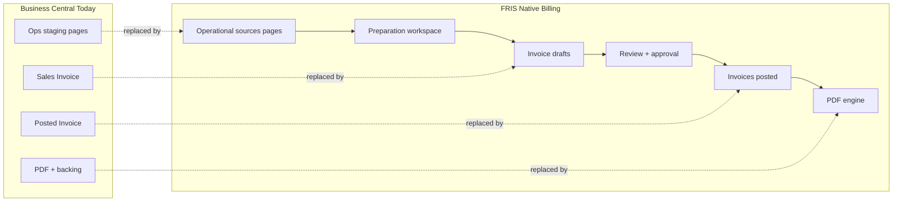

# Business Central → FRIS Page Mapping

**Purpose:** Every audited BC page/feature maps to a FRIS native billing equivalent. No audited functionality should be lost.

**Legend:**
- **Audit file** — source documentation
- **Status** — `Exists` | `Partial` | `Missing` | `Verify`

---

## Master data

| BC Module | BC Page (Tell Me) | FRIS Page | Mongo Collection | API (planned) | Status |
|-----------|-------------------|-----------|------------------|---------------|--------|
| Master | Customers | `/billing/customers` | `billing_customers` (+ `advance-airline`) | `GET/POST/PATCH /billing/customers` | Partial |
| Master | Items / Service codes | `/billing/service-catalog` | `billing_service_catalog` (+ `EXPORT_LOG_TYPE_LABELS` seed) | `GET/POST/PATCH /billing/service-catalog` | Partial |
| Master | G/L Accounts | `/billing/settings/gl-accounts` (read-only ref) | `billing_settings.glAccounts` | `GET /billing/settings/gl-accounts` | Missing |
| Master | Dimensions | `/billing/settings/dimensions` | `billing_settings.dimensions` | `GET/PATCH /billing/settings/dimensions` | Missing |
| Master | Dimension Values | `/billing/settings/dimensions/:code` | `billing_settings.dimensionValues` | `GET/POST /billing/settings/dimensions/:code/values` | Missing |
| Master | Currencies | `/billing/settings/currency` | `billing_exchange_rates` | `GET/POST /billing/exchange-rates` | Missing |
| Master | Currency Exchange Rates | `/billing/settings/currency` | `billing_exchange_rates` | `GET/POST /billing/exchange-rates` | Missing |
| Master | Payment Terms | `/billing/customers/:id` (tab) | `billing_customers.paymentTerms` | `PATCH /billing/customers/:id` | Missing |
| Master | Units of Measure | `/billing/service-catalog` (UOM column) | `billing_service_catalog.uom` | `GET /billing/service-catalog/uoms` | Partial |
| Master | Contract | `/billing/contracts` | `billing_contracts`, `billing_contract_versions` | `GET/POST/PATCH /billing/contracts` | Missing |
| Master | Tariff / Rate | `/billing/rate-cards` | `billing_rate_cards` (+ `bhs_revenue_master` migrate) | `GET/POST/PATCH /billing/rate-cards` | Partial |

**Audit files:** `BC_SCREEN_INVENTORY.md` §A, `BC_FIELD_DICTIONARY.csv`

---

## Sales module

| BC Module | BC Page | FRIS Page | Mongo Collection | API | Status |
|-----------|---------|-----------|------------------|-----|--------|
| Sales | Sales Invoices (unposted) | `/billing/invoice-drafts`, `/billing/invoices?status=draft` | `billing_invoice_drafts`, `billing_invoice_headers` | `GET/POST/PATCH /billing/invoices` | Missing |
| Sales | Posted Sales Invoices | `/billing/invoices?status=posted` | `billing_invoice_headers` (status=posted) | `GET /billing/invoices`, `POST /billing/invoices/:id/post` | Missing |
| Sales | Sales Invoice card (detail) | `/billing/invoices/:id` | `billing_invoice_headers`, `billing_invoice_lines` | `GET /billing/invoices/:id` | Missing |
| Sales | Sales Credit Memos | `/billing/credit-memos` | `billing_credit_memos` | `GET/POST/PATCH /billing/credit-memos` | Missing |
| Sales | Posted Sales Credit Memos | `/billing/credit-memos?status=posted` | `billing_credit_memos` | `POST /billing/credit-memos/:id/post` | Missing |
| Sales | Customers (sales view) | `/billing/customers/:id` | `billing_customers` | `GET /billing/customers/:id` | Missing |
| Sales | Customer Ledger Entries | `/billing/customers/:id/ledger` | `billing_invoice_headers` (AR fields) | `GET /billing/customers/:id/ledger` | Missing |
| Sales | Reminders | `/billing/reports/ar-aging` | `billing_reports` | `GET /billing/reports/ar-aging` | Missing |
| Sales | Sales Quotes / Orders / Shipments | — (out of scope) | — | — | N/A |

**Audit files:** `BC_SALES_NAV_AUDIT.md`, `BC_SCREEN_INVENTORY.md` §C

---

## Operational intake (aviation → billing sources)

| BC Page (Tell Me) | FRIS Page | Source Mongo | API | Status |
|-------------------|-----------|--------------|-----|--------|
| Flight / FHR / Serial | `/billing/scheduled-flights` | `fhr_collection`, `raw_flight_data` | `GET /billing/sources/scheduled-flights` | Partial |
| FRIS / NAV staging | `/billing/preparation` | `billing_preparation_records` | `GET/POST /billing/preparation` | Missing |
| Equipment | `/billing/equipment` | `ads_usage_data`, FHR embed | `GET /billing/sources/equipment` | Missing |
| Cleaning | `/billing/cleaning` | `fhr_collection` (cleaning times) | `GET /billing/sources/cleaning` | Missing |
| MAAS | `/billing/maas` | Pax shift forms, `psr-*` | `GET /billing/sources/maas` | Missing |
| RAF | `/billing/raf` | `raf_usage_data` | `GET /billing/sources/raf` | Missing |
| ADS | `/billing/ads` (embedded in equipment) | `ads_usage_data`, `ads_metadata_rows` | `GET /billing/sources/ads` | Missing |
| XXLD | `/billing/xxld-scheduled`, `/billing/xxld-non-scheduled` | `fhr_collection`, cancellations | `GET /billing/sources/xxld` | Missing |
| Manpower | `/billing/manpower` | FHR embed, ADS | `GET /billing/sources/manpower` | Missing |
| Non-scheduled | `/billing/scheduled-flights?ns=true` | `ns_raw_flight_data` | `GET /billing/sources/non-scheduled` | Missing |
| Job Queue Entries | `/billing/audit` (import jobs) | `billing_audit_logs` | `GET /billing/audit/import-jobs` | Missing |
| Handling / Contract | `/billing/contracts`, `/billing/rate-cards` | `bhs_revenue_master` | `GET /billing/contracts` | Partial |

**Legacy FRIS pages (to migrate):**

| Legacy | New |
|--------|-----|
| `/fris/advance?tab=invoicing` | `/billing/*` |
| `/others/invoice-pending` | `/billing/preparation?tab=pending` |
| `/others/exported-data-log` | `/billing/audit?type=export` |
| `/others/invoice-pending/exported-error-report` | `/billing/preparation?tab=errors` |

**Audit files:** `AVIATION_PAGES.md`, `BC_DATA_FLOW.md` §1–2, `GAP_LIST.md`

---

## Billing preparation & invoice workflow

| BC Workflow step | FRIS Page | Mongo | API |
|------------------|-----------|-------|-----|
| Staging / import review | `/billing/preparation` | `billing_preparation_records` | `GET /billing/preparation` |
| Eligible queue | `/billing/preparation?tab=eligible` | `billing_preparation_records` | `GET /billing/preparation?status=eligible` |
| Validation errors | `/billing/preparation?tab=errors` | `billing_preparation_records` | `GET /billing/preparation?status=validation_error` |
| Ready for invoice | `/billing/preparation?tab=ready` | `billing_preparation_records` | `POST /billing/preparation/:id/ready` |
| Draft creation | `/billing/invoice-drafts` | `billing_invoice_drafts` | `POST /billing/invoice-drafts` |
| Finance review | `/billing/review` | `billing_invoice_drafts` | `GET /billing/review` |
| Approval | `/billing/invoices/:id` (approval tab) | `billing_approvals` | `POST /billing/invoices/:id/approve` |
| Post | `/billing/invoices/:id` | `billing_invoice_headers` | `POST /billing/invoices/:id/post` |
| PDF | `/billing/invoices/:id` (PDF action) | — | `GET /billing/invoices/:id/pdf` |
| Backing sheet | `/billing/backing-sheets`, invoice tab | `billing_backing_sheets` | `GET /billing/invoices/:id/backing-sheet/pdf` |

---

## Reports & PDFs

| BC Report | FRIS Page / Action | Mongo | API |
|-----------|-------------------|-------|-----|
| Sales - Invoice | Invoice detail → Download PDF | — | `GET /billing/invoices/:id/pdf` |
| Backing sheet | Invoice detail → Backing Sheets tab | `billing_backing_sheets` | `GET /billing/invoices/:id/backing-sheet/pdf` |
| Customer Trial Balance | `/billing/reports/customer-trial-balance` | `billing_reports` | `GET /billing/reports/customer-trial-balance` |
| Aged AR | `/billing/reports/ar-aging` | `billing_reports` | `GET /billing/reports/ar-aging` |
| Rev_Summary equivalent | `/billing/reports/revenue-summary` | `billing_reports` | `GET /billing/reports/revenue-summary` |
| Reco_Skd equivalent | `/billing/reports/schedule-reconciliation` | `billing_reports` | `GET /billing/reports/schedule-reconciliation` |
| Delay Flt equivalent | `/billing/reports/delay-charges` | `billing_reports` | `GET /billing/reports/delay-charges` |
| Addl & XXLD equivalent | `/billing/reports/xxld-decisions` | `billing_reports` | `GET /billing/reports/xxld-decisions` |
| Monthly billing summary | `/billing/reports/monthly-summary` | `billing_reports` | `GET /billing/reports/monthly-summary` |
| Tax summary | `/billing/reports/tax-summary` | `billing_reports` | `GET /billing/reports/tax-summary` |
| Navision export errors | `/billing/preparation?tab=errors` | — | `GET /billing/sources/export-errors` (wraps existing) |
| Exported Data Log | `/billing/audit?type=export` | `billing_audit_logs` | `GET /billing/audit` |

**Audit files:** `BC_REPORTS.md`, `SAMPLE_INVOICES.md`

---

## Settings & administration

| BC Feature | FRIS Page | Mongo | API |
|------------|-----------|-------|-----|
| Invoice numbering | `/billing/settings/sequences` | `billing_sequences` | `GET/POST/PATCH /billing/sequences` |
| Tax rules / GST | `/billing/settings/taxes` | `billing_tax_rules` | `GET/POST/PATCH /billing/tax-rules` |
| Exchange rates | `/billing/settings/currency` | `billing_exchange_rates` | `GET/POST /billing/exchange-rates` |
| Billing settings | `/billing/settings` | `billing_settings` | `GET/PATCH /billing/settings` |
| Audit trail | `/billing/audit` | `billing_audit_logs` | `GET /billing/audit` |
| Dashboard | `/billing/dashboard` | aggregates | `GET /billing/dashboard` |

---

## Complete page traceability matrix

Every implemented billing page must document:

| BC Page | Audit File | FRIS Page | API Endpoint | Mongo Collection |
|---------|------------|-----------|--------------|------------------|
| Sales Invoices | `BC_SALES_NAV_AUDIT.md` §3 | `/billing/invoices` | `GET /billing/invoices` | `billing_invoice_headers` |
| Posted Sales Invoices | `BC_SALES_NAV_AUDIT.md` §4 | `/billing/invoices?status=posted` | `GET /billing/invoices?status=posted` | `billing_invoice_headers` |
| Sales Credit Memos | `BC_SALES_NAV_AUDIT.md` §5.2 | `/billing/credit-memos` | `GET /billing/credit-memos` | `billing_credit_memos` |
| Customers | `BC_SCREEN_INVENTORY.md` §A1 | `/billing/customers` | `GET /billing/customers` | `billing_customers` |
| Items | `BC_SCREEN_INVENTORY.md` §A2 | `/billing/service-catalog` | `GET /billing/service-catalog` | `billing_service_catalog` |
| Scheduled Flight export | `BC_SCREEN_INVENTORY.md` §B1 | `/billing/scheduled-flights` | `GET /billing/sources/scheduled-flights` | `fhr_collection`, `raw_flight_data` |
| FHR backing | `BC_SALES_NAV_AUDIT.md` §3.5 | `/billing/backing-sheets` | `GET /billing/invoices/:id/backing-sheet` | `billing_backing_sheets` |
| Contract/Tariff | `BC_SCREEN_INVENTORY.md` §A7 | `/billing/contracts`, `/billing/rate-cards` | `GET /billing/contracts` | `billing_contracts`, `billing_rate_cards` |
| Currencies/ROE | `BC_SCREEN_INVENTORY.md` §A5 | `/billing/settings/currency` | `GET /billing/exchange-rates` | `billing_exchange_rates` |
| Preparation workspace | `BC_DATA_FLOW.md` §3–4 | `/billing/preparation` | `GET /billing/preparation` | `billing_preparation_records` |

---

## Data flow mapping (BC → FRIS)

---

## Migration notes

1. **`exportedNAV` flag** — retained during transition; native billing uses `billing_preparation_records.status` instead of sole export indicator.
2. **`advance-airline`** — remains ops master; `billing_customers` extends with finance fields (GSTIN, payment terms, posting groups).
3. **`bhs_revenue_master`** — seed/migrate into `billing_contracts` + `billing_rate_cards`.
4. **`EXPORT_LOG_TYPE_LABELS`** — seed `billing_service_catalog` (140+ codes).
5. **Existing invoicing API** — `GET /advance-invoicing/scheduled-flight-data` wrapped by `/billing/sources/scheduled-flights` during transition; deprecate after cutover.
