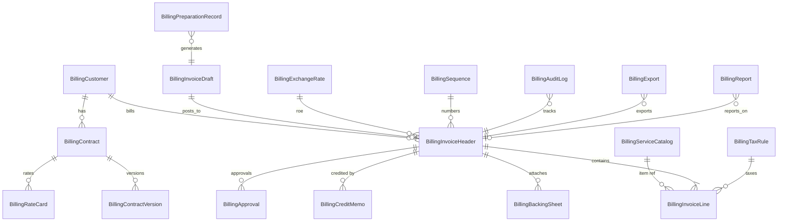

# Billing Domain Model

**Purpose:** Entity-relationship design for FRIS native billing, derived from BC audit and existing Mongo operational data.

---

## Entity overview



---

## Customer

**Collection:** `billing_customers`  
**BC equivalent:** Customer card (Sell-to Customer)

| Attribute | Type | Required | Notes |
|-----------|------|----------|-------|
| `customerCode` | string | Yes | Maps to `advance-airline.code` |
| `name` | string | Yes | Legal airline name |
| `billToCustomerCode` | string | No | Usually self |
| `currencyCode` | enum | Yes | INR / USD |
| `paymentTermsCode` | string | No | Net 30 etc. |
| `gstRegistrationNo` | string | No | Customer GSTIN |
| `gstBusPostingGroup` | string | No | VAT bus. posting group |
| `genBusPostingGroup` | string | No | Gen. bus. posting group |
| `blocked` | boolean | No | Blocks posting |
| `creditLimit` | decimal | No | AR control |
| `globalDimension1` | string | No | Station — VERIFY |
| `globalDimension2` | string | No | Airline category — VERIFY |
| `stationCode` | string | Yes | Station scope |
| `advanceAirlineId` | ObjectId | No | Link to `advance-airline` |
| `contacts` | array | No | Bill-to addresses |
| `active` | boolean | Yes | Default true |

**Relationships:** One customer has many contracts, invoices, credit memos.

---

## Contract

**Collection:** `billing_contracts`  
**BC equivalent:** Contract / tariff / handling agreement pages

| Attribute | Type | Required | Notes |
|-----------|------|----------|-------|
| `contractNumber` | string | Yes | Unique per station |
| `customerCode` | string | Yes | FK to customer |
| `stationCode` | string | Yes | |
| `category` | enum | Yes | Dom / Int |
| `aircraftTypes` | string[] | No | Applicable aircraft |
| `priceValidFrom` | date | Yes | |
| `priceValidTo` | date | Yes | |
| `royaltyAtGross` | decimal | No | % from Rev_Summary |
| `royaltyInclusive` | boolean | No | Inc/Exc |
| `xxlnClause` | text | No | Cancellation clause text |
| `delayClause` | text | No | Delay waiver rules |
| `flightsPerSchedule` | integer | No | Reco_Skd reference |
| `status` | enum | Yes | draft / active / expired |
| `currentVersionId` | ObjectId | No | Pointer to active version |

**Source migration:** `bhs_revenue_master` rows.

---

## Contract Version

**Collection:** `billing_contract_versions`  
Immutable snapshot when contract terms change.

| Attribute | Type | Notes |
|-----------|------|-------|
| `contractId` | ObjectId | Parent contract |
| `version` | integer | Incrementing |
| `effectiveFrom` | date | |
| `terms` | object | Full clause snapshot |
| `createdBy` | string | Audit |
| `createdAt` | date | |

---

## Rate Card

**Collection:** `billing_rate_cards`  
**BC equivalent:** Rate / tariff / CR ceiling sheet

| Attribute | Type | Required | Notes |
|-----------|------|----------|-------|
| `contractId` | ObjectId | Yes | Parent contract |
| `customerCode` | string | Yes | Denormalized |
| `serviceCode` | string | Yes | FK to service catalog |
| `category` | string | No | Dom C, Int B, etc. |
| `unitPriceINR` | decimal | No | |
| `unitPriceUSD` | decimal | No | |
| `ceilingRateINR` | decimal | No | CR sheet cap |
| `ceilingRateUSD` | decimal | No | |
| `currency` | enum | Yes | INR / USD |
| `uom` | string | Yes | FLIGHT, MIN, HR |
| `minBillableUnits` | integer | No | RAF/ADS minimum |
| `discountPercent` | decimal | No | |
| `discountDelayPercent` | decimal | No | Delay-specific |
| `royaltyRate` | decimal | No | |
| `validFrom` / `validTo` | date | Yes | |
| `stationCode` | string | Yes | |

**Source migration:** `bhs_revenue_master.basicRateUSD/INR`, CR sheet.

---

## Service Catalog

**Collection:** `billing_service_catalog`  
**BC equivalent:** Items (service codes)

| Attribute | Type | Required | Notes |
|-----------|------|----------|-------|
| `serviceCode` | string | Yes | Unique — e.g. GPU-90KV |
| `description` | string | Yes | Human label |
| `lineType` | enum | Yes | service / adjustment |
| `category` | enum | Yes | scheduled / non-scheduled / raf / xxld / delay |
| `uom` | string | Yes | FLIGHT, MIN, HR |
| `gstProdPostingGroup` | string | No | GST % group |
| `sacCode` | string | No | SAC/HSN — VERIFY |
| `royaltyApplicable` | boolean | No | |
| `active` | boolean | Yes | |
| `exportLogType` | string | No | Maps to EXPORT_LOG_TYPE_LABELS |

**Seed:** 140+ codes from `exported-data-log-type-options.ts`.

---

## Billing Period

Logical entity (not a separate collection) — represented on invoice header and preparation records.

| Attribute | Notes |
|-----------|-------|
| `periodStart` | First day of billing month |
| `periodEnd` | Last day of billing month |
| `postingDate` | Month-close date |
| `documentDate` | Legal invoice date |

---

## Invoice

**Collections:** `billing_invoice_drafts` (pre-post), `billing_invoice_headers` (post and after)

### Invoice Header

| Attribute | Type | Required | Notes |
|-----------|------|----------|-------|
| `invoiceNumber` | string | No until post | From sequence |
| `draftNumber` | string | Yes for drafts | Pre-post doc no. |
| `customerCode` | string | Yes | Sell-to |
| `customerName` | string | Yes | Denormalized |
| `billToCustomerCode` | string | No | |
| `status` | enum | Yes | See status machine below |
| `postingDate` | date | No until post | |
| `documentDate` | date | Yes | |
| `dueDate` | date | No | From payment terms |
| `currencyCode` | enum | Yes | INR / USD |
| `currencyFactor` | decimal | Yes if FCY | ROE |
| `pricesIncludingVat` | boolean | No | VERIFY |
| `workDescription` | string | No | Period narrative |
| `externalDocumentNo` | string | No | Airline PO |
| `shortcutDimension1` | string | No | Station |
| `shortcutDimension2` | string | No | Airline/category |
| `subtotalExclTax` | decimal | Calc | |
| `taxTotal` | decimal | Calc | |
| `totalInclTax` | decimal | Calc | |
| `remainingAmount` | decimal | Post only | AR open |
| `stationCode` | string | Yes | |
| `billingPeriodStart` | date | Yes | |
| `billingPeriodEnd` | date | Yes | |
| `contractId` | ObjectId | No | Matched contract |
| `approvalStatus` | enum | No | pending / approved / rejected |
| `postedAt` | date | Post only | |
| `postedBy` | string | Post only | |
| `cancelled` | boolean | No | |
| `correctedFromInvoiceId` | ObjectId | No | Correction chain |

### Status machine

```
draft → pending_approval → approved → generated → posted → [cancelled | archived]
```

| Status | Meaning |
|--------|---------|
| `draft` | Editable invoice draft |
| `pending_approval` | Awaiting finance approval |
| `approved` | Approved, ready to generate PDF |
| `generated` | PDF generated, ready to post |
| `posted` | Legal invoice — immutable |
| `cancelled` | Voided (credit memo chain) |
| `archived` | Historical read-only |

---

## Invoice Line

**Collection:** `billing_invoice_lines`

| Attribute | Type | Required | Notes |
|-----------|------|----------|-------|
| `invoiceId` | ObjectId | Yes | Parent header |
| `lineNo` | integer | Yes | Sequence within invoice |
| `lineType` | enum | Yes | service / royalty / delay / xxld / adjustment |
| `serviceCode` | string | Yes | Item No. |
| `description` | string | Yes | Flight ref + service |
| `quantity` | decimal | Yes | flights, minutes, hours |
| `uom` | string | Yes | |
| `unitPrice` | decimal | Yes | Contract rate |
| `lineDiscountPercent` | decimal | No | |
| `lineAmountExclTax` | decimal | Calc | |
| `gstPercent` | decimal | Yes | 18 typical |
| `cgstAmount` | decimal | Calc | |
| `sgstAmount` | decimal | Calc | |
| `igstAmount` | decimal | Calc | |
| `lineAmountInclTax` | decimal | Calc | |
| `royaltyAmount` | decimal | No | |
| `shortcutDimension1` | string | No | Serial/station |
| `shortcutDimension2` | string | No | |
| `sourceType` | enum | No | scheduled / equipment / raf / ads / cleaning / maas / xxld / delay |
| `sourceRef` | object | No | `{ serialNo, flightNo, preparationRecordId }` |
| `stationCode` | string | Yes | |

**Line types on one invoice (from audit):** Basic handling, equipment, manpower, cleaning, delay, XXLD, RAF, royalty.

---

## Backing Sheet

**Collection:** `billing_backing_sheets`

| Attribute | Type | Notes |
|-----------|------|-------|
| `invoiceId` | ObjectId | Parent invoice |
| `customerCode` | string | |
| `billingPeriod` | object | start/end |
| `rows` | array | 49-column objects per serial |
| `rowCount` | integer | |
| `generatedAt` | date | |
| `pdfStorageKey` | string | S3/R2 key if stored |
| `stationCode` | string | |

**Row schema:** Matches `invoicing-flight-report.mapper.ts` output (serialNumber, flightNoEquipmentNo, staDate…entryNo).

---

## Credit Memo

**Collection:** `billing_credit_memos`

| Attribute | Type | Notes |
|-----------|------|-------|
| `creditMemoNumber` | string | Assigned on post |
| `customerCode` | string | |
| `appliesToInvoiceId` | ObjectId | Original invoice |
| `appliesToInvoiceNo` | string | Denormalized |
| `status` | enum | draft / posted |
| `postingDate` | date | |
| `currencyCode` | enum | |
| `currencyFactor` | decimal | |
| `lines` | array | Same structure as invoice lines (negative) |
| `reason` | enum | xxld_not_chargeable / delay_dispute / correction |
| `xxldDecision` | object | Conclusion, Resulted from Addl & XXLD sheet |
| `totalInclTax` | decimal | |
| `stationCode` | string | |

**Triggers:** XXLD Not Chargeable, delay waiver, invoice correction (BC Correct Invoice).

---

## Tax Rule

**Collection:** `billing_tax_rules`

| Attribute | Type | Notes |
|-----------|------|-------|
| `ruleCode` | string | Unique |
| `gstPercent` | decimal | 18, 0, etc. |
| `placeOfSupply` | enum | intra_state / inter_state |
| `cgstPercent` | decimal | Split |
| `sgstPercent` | decimal | Split |
| `igstPercent` | decimal | Split |
| `serviceCodePattern` | string | Optional filter |
| `customerGstGroup` | string | Optional filter |
| `effectiveFrom` / `effectiveTo` | date | |
| `stationCode` | string | India station scope |

---

## Exchange Rate

**Collection:** `billing_exchange_rates`

| Attribute | Type | Notes |
|-----------|------|-------|
| `currencyCode` | string | USD |
| `rateToINR` | decimal | e.g. 87.5544 |
| `startingDate` | date | Month-close ROE |
| `relationalRate` | decimal | VERIFY BC formula |
| `source` | enum | manual / rbi / import |
| `stationCode` | string | Optional — may be global |

---

## Approval

**Collection:** `billing_approvals`

| Attribute | Type | Notes |
|-----------|------|-------|
| `documentType` | enum | invoice / credit_memo |
| `documentId` | ObjectId | |
| `status` | enum | pending / approved / rejected |
| `requestedBy` | string | |
| `requestedAt` | date | |
| `approvedBy` | string | |
| `approvedAt` | date | |
| `rejectedBy` | string | |
| `rejectionReason` | string | |
| `stationCode` | string | |

**BC equivalent:** Release / Request Approval on Sales Invoice.

---

## Audit Log

**Collection:** `billing_audit_logs`

| Attribute | Type | Notes |
|-----------|------|-------|
| `entityType` | enum | invoice / credit_memo / contract / customer / preparation |
| `entityId` | ObjectId | |
| `action` | enum | created / updated / approved / rejected / generated / posted / exported / downloaded / cancelled |
| `userId` | string | |
| `userName` | string | |
| `timestamp` | date | |
| `changes` | object | Field-level diff |
| `ipAddress` | string | Optional |
| `stationCode` | string | |

---

## Export

**Collection:** `billing_exports`

| Attribute | Type | Notes |
|-----------|------|-------|
| `exportType` | enum | invoice_pdf / backing_pdf / excel_reconciliation / ar_export |
| `documentId` | ObjectId | |
| `fileName` | string | |
| `storageKey` | string | |
| `exportedBy` | string | |
| `exportedAt` | date | |
| `recipient` | string | Email if sent |
| `stationCode` | string | |

---

## Report

**Collection:** `billing_reports`

| Attribute | Type | Notes |
|-----------|------|-------|
| `reportType` | enum | revenue_summary / schedule_reconciliation / delay_charges / xxld_decisions / tax_summary / monthly_summary / ar_aging |
| `parameters` | object | period, customerCode, stationCode |
| `generatedAt` | date | |
| `generatedBy` | string | |
| `data` | object | Computed report payload |
| `storageKey` | string | PDF/Excel if persisted |
| `stationCode` | string | |

---

## Billing Preparation Record

**Collection:** `billing_preparation_records`

Bridge entity between operational data and invoice drafts.

| Attribute | Type | Notes |
|-----------|------|-------|
| `sourceType` | enum | scheduled_flight / equipment / cleaning / raf / maas / ads / xxld / manpower / non_scheduled |
| `sourceRef` | object | serialNo, flightNo, batchId, usageRowId |
| `customerCode` | string | |
| `billingPeriod` | object | |
| `status` | enum | eligible / pending / validation_error / rejected / ready_for_invoice / invoiced |
| `contractMatch` | object | contractId, rateCardId, matched |
| `rateMatch` | object | serviceCode, unitPrice, currency |
| `validationResults` | array | `{ rule, passed, message }` |
| `invoiceDraftId` | ObjectId | When assigned |
| `invoiceId` | ObjectId | When posted |
| `stationCode` | string | |

---

## Sequence

**Collection:** `billing_sequences`

| Attribute | Type | Notes |
|-----------|------|-------|
| `sequenceCode` | string | e.g. SI-HYD |
| `prefix` | string | SI-HYD/25-26/ |
| `currentValue` | integer | Atomic increment |
| `fiscalYear` | string | 25-26 |
| `documentType` | enum | invoice / credit_memo |
| `stationCode` | string | |

---

## Settings

**Collection:** `billing_settings`

| Attribute | Notes |
|-----------|-------|
| `stationCode` | Per-station config |
| `defaultPaymentTerms` | |
| `defaultGstGroup` | |
| `dimensionMappings` | station → dim1, airline → dim2 |
| `approvalRequired` | boolean |
| `monthCloseLockDay` | integer |
| `companyLegalEntity` | PDF header block |
| `bankDetails` | Encrypted / env — not in git |

---

## Domain invariants

1. **Serial uniqueness:** One posted invoice line per FHR/serial per service type per period (VERIFY BC rule).
2. **Station isolation:** All billing entities scoped by `stationCode`.
3. **Posted immutability:** Posted invoices cannot be edited — only credit memo correction.
4. **Contract validity:** Rates must fall within `priceValidFrom/To`.
5. **ROE required:** Foreign currency invoices require exchange rate for posting date.
6. **Cancelled flights:** Excluded from preparation unless XXLD chargeable.
7. **Month-close:** Posting blocked after lock date for period.
