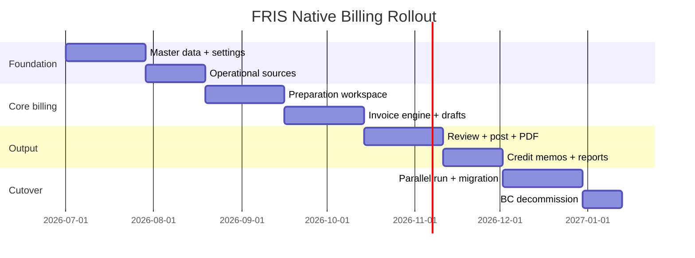
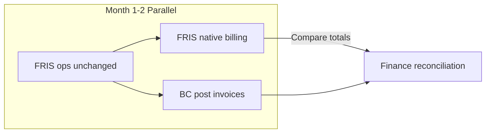

# Billing Implementation Plan

**Status:** Architecture phase complete — implementation begins after stakeholder review of `billing/docs/*`  
**Scope:** Full BC invoicing replacement for GBASPL (BWFS Hyderabad first, multi-station extensible)

---

## Phase overview

---

## Implementation order (pages)

Matches mandated build sequence. **Do not start with invoices.**

| Step | Page | Dependencies | Est. duration |
|------|------|--------------|---------------|
| 1 | `/billing/dashboard` | Billing module scaffold, auth | 1 week |
| 2 | `/billing/customers` | `billing_customers` schema | 1 week |
| 3 | `/billing/service-catalog` | Seed script | 1 week |
| 4 | `/billing/contracts` | Customers, catalog | 2 weeks |
| 5 | `/billing/rate-cards` | Contracts, `bhs_revenue_master` migration | 2 weeks |
| 6 | `/billing/settings/taxes` | Settings module | 1 week |
| 7 | `/billing/settings/currency` | Exchange rates schema | 1 week |
| 8 | `/billing/settings/sequences` | Sequences schema | 0.5 week |
| 9 | Operational sources (9 pages) | Sources services, validation engine (partial) | 3 weeks |
| 10 | `/billing/preparation` | Sources, contracts, rates, validation | 4 weeks |
| 11 | `/billing/invoice-drafts` | Invoice engine | 2 weeks |
| 12 | `/billing/review` | Drafts, validation engine | 2 weeks |
| 13 | `/billing/invoices` | Review, approval, sequences | 3 weeks |
| 14 | `/billing/invoices/:id` | Lines, backing, audit | 2 weeks |
| 15 | `/billing/credit-memos` | Posted invoices | 2 weeks |
| 16 | `/billing/backing-sheets` | Backing engine, mapper reuse | 1 week |
| 17 | `/billing/reports` | Reporting engine | 3 weeks |
| 18 | PDF engine | PdfEngineService, storage | 2 weeks |
| 19 | `/billing/audit` | Audit engine (wire early, display late) | 1 week |

**Total estimate:** ~32 weeks with 2 full-stack engineers; parallelizable to ~20 weeks with 3 engineers.

---

## Phase 0 — Prerequisites (before Step 1)

| Task | Owner | Status |
|------|-------|--------|
| Review architecture docs with finance lead | Finance | Pending |
| Obtain redacted posted PDF samples (INR + USD) | Finance | Pending |
| Confirm invoice number format | Finance | Pending |
| Confirm BC ingest path from `exportedNAV` | IT | Pending |
| Confirm dimension codes | Finance | Pending |
| Re-authenticate BC for live screenshot pass | IT | Pending |
| Add `billing` permission tab to admin panel | Engineering | Not started |
| Create `server/src/billing/` module scaffold | Engineering | Not started |
| Create `client/app/billing/` route scaffold | Engineering | Not started |

---

## Phase 1 — Foundation (Steps 1–8)

### Deliverables

- NestJS `BillingModule` registered in `app.module.ts`
- All master data collections + Mongoose schemas
- CRUD APIs for customers, catalog, contracts, rate cards, settings
- Migration script: `billing/scripts/migrate-bhs-revenue-master.mjs`
- Seed script: `billing/scripts/seed-service-catalog.mjs`
- Frontend layout + sidebar + dashboard KPIs
- Permission gating for billing routes

### Dependencies

- Existing `advance-airline` for customer sync
- `exported-data-log-type-options.ts` for catalog seed
- `bhs_revenue_master` Mongo data for contract migration

### Risks

| Risk | Mitigation |
|------|------------|
| Incomplete contract data (18 rows) | Finance data entry sprint for missing airlines |
| GST rules unknown | Default 18% CGST/SGST; refine after finance input |

### Testing

- Unit tests for rate match logic
- Integration tests for customer sync
- Manual: CRUD all master data pages

---

## Phase 2 — Operational sources (Step 9)

### Deliverables

- `BillingSourcesController` with 9 source endpoints
- Mongoose schemas for `ads_usage_data`, `raf_usage_data` (read-only initially)
- Unified source row component with eligibility/contract/rate/validation columns
- Wrap existing `AdvanceInvoicingService` for scheduled flights

### Dependencies

- Phase 1 contracts + rate cards for match display
- Partial validation engine

### Risks

| Risk | Mitigation |
|------|------------|
| MAAS has no dedicated collection | Extract from PSR forms; scope MAAS as phase 2b if blocked |
| `ads_usage_data` not station-aware | Add station filter in queries; plan stationAware migration |

### Testing

- Compare scheduled flight output with existing Advance → Invoicing grid (parity test)
- RAF/ADS row counts vs Mongo direct query

---

## Phase 3 — Preparation workspace (Step 10)

### Deliverables

- `billing_preparation_records` full lifecycle
- `BillingPreparationService` ingest + status transitions
- `ValidationEngineService` v1 (flight readiness, contract, rate, duplicate)
- Preparation UI with 5 tabs + bulk actions

### Dependencies

- Phase 2 sources
- Phase 1 contracts + rates

### Risks

| Risk | Mitigation |
|------|------------|
| Validation rules incomplete without live BC | Implement from `BC_VALIDATION_RULES.md`; flag VERIFY rules as configurable |
| Performance on large month datasets | Indexed queries, pagination, background ingest job |

### Testing

- E2E: ingest 100 serials → validate → mark ready
- Validation rule unit tests per category (delay, XXLD, ceiling)

---

## Phase 4 — Invoice engine (Steps 11–14)

### Deliverables

- `InvoiceEngineService` — line composition from preparation records
- `TaxEngineService`, `CurrencyEngineService`
- Invoice drafts + review + post APIs
- `ApprovalWorkflowService`
- Invoice list + detail UI with all tabs
- `BackingSheetEngineService` reusing `invoicing-flight-report.mapper.ts`

### Dependencies

- Phase 3 preparation ready records
- Phase 1 sequences for numbering

### Risks

| Risk | Mitigation |
|------|------------|
| Royalty presentation unknown | Support both separate line and embedded; configurable per customer |
| PDF layout unknown | Iterative design against finance samples; start with functional layout |
| Reconciliation engine complex | MVP: flight count check; full Reco_Skd in Phase 5 reports |

### Testing

- Golden test: one airline-month invoice vs finance Excel pack totals
- Post immutability tests
- Backing sheet 49-column parity with existing mapper

---

## Phase 5 — Output & exceptions (Steps 15–19)

### Deliverables

- `PdfEngineService` — invoice + backing PDFs
- `BillingCreditMemosService` — XXLD not chargeable, corrections
- `ReportingEngineService` — 5 reconciliation reports
- `ExportEngineService` — Excel reconciliation pack
- Audit trail UI
- Dashboard KPIs wired to real data

### Dependencies

- Phase 4 posted invoices

### Risks

| Risk | Mitigation |
|------|------------|
| PDF GST compliance | Finance sign-off on template before cutover |
| Credit memo workflow rarely used | Prioritize XXLD not chargeable path from audit |

### Testing

- PDF snapshot tests (visual diff)
- Credit memo apply-to-invoice balance check
- Report totals vs invoice totals

---

## Phase 6 — Migration & cutover

### Parallel run strategy

| Week | Activity |
|------|----------|
| 1–4 | Parallel: FRIS generates drafts; BC still posts official invoices |
| 5–8 | Compare PDFs and totals; fix discrepancies |
| 9 | Finance sign-off on one full month |
| 10 | FRIS posts official invoices; BC read-only |
| 11–12 | BC decommission for invoicing |

### Data migration

| Step | Script | When |
|------|--------|------|
| Seed service catalog | `seed-service-catalog.mjs` | Phase 1 |
| Migrate contracts/rates | `migrate-bhs-revenue-master.mjs` | Phase 1 |
| Sync customers from advance-airline | API endpoint | Ongoing |
| Backfill preparation from exportedNAV | `backfill-preparation.mjs` | Phase 3 |
| Import posted invoice history (optional) | Finance CSV import | Phase 6 if needed for AR |

### Rollback plan

- Keep BC access until 2 successful FRIS-only month closes
- `exportedNAV` flag path remains functional during parallel run
- Feature flag `BILLING_NATIVE_ENABLED` per station

---

## Dependencies matrix

| Component | Depends on |
|-----------|------------|
| Preparation | Sources, contracts, rates, validation |
| Invoice engine | Preparation, tax, currency, catalog |
| Review | Invoice engine, validation |
| Post | Review, approval, sequences |
| PDF | Posted invoice, backing engine |
| Credit memos | Posted invoices |
| Reports | Posted invoices, preparation data |
| Dashboard | All modules (incremental) |

---

## Risks register

| # | Risk | Impact | Likelihood | Mitigation |
|---|------|--------|------------|------------|
| R1 | BC ingest path unknown | Cannot validate export parity | High | Finance interview; accept FRIS-native as new source of truth |
| R2 | No live PDF samples | Layout mismatch | High | Finance provides samples in Phase 0 |
| R3 | Incomplete contract master | Wrong rates | Medium | Data entry sprint; block post without contract |
| R4 | Delay/XXLD rules complex | Revenue disputes | Medium | Configurable rules per contract; finance override |
| R5 | Performance at month-close | Slow UX | Medium | Indexes, pagination, async report generation |
| R6 | Workers bundle size | Deploy failure | Low | PDF generation on Nest only; keep billing API lean |
| R7 | Station scope gaps on ADS/RAF | Cross-station leak | Medium | Add station filters; migrate to stationAware |
| R8 | User adoption | Parallel Excel use | Medium | Training; preparation workspace replaces Excel |

---

## Testing strategy

| Layer | Approach |
|-------|----------|
| Unit | Validation rules, tax calc, rate match, sequence increment |
| Integration | API endpoints with test Mongo |
| Parity | Scheduled flight grid vs existing advance-invoicing |
| Golden | One airline-month vs finance Excel pack |
| E2E | Playwright: preparation → draft → review → post → PDF |
| UAT | Finance team month-close dry run |
| Load | 10k preparation records ingest benchmark |

---

## Performance considerations

- Compound indexes on all list queries (see `DATABASE_DESIGN.md`)
- Server-side pagination default 50, max 200
- Backing sheet generation async for >200 rows
- Report generation via background job with polling status
- React Query staleTime 30s for source lists; invalidate on ingest
- EXPORT throttle on PDF endpoints

---

## Rollout plan

| Station | Phase | Target |
|---------|-------|--------|
| HYD (Hyderabad) | Pilot | First native post |
| Other stations | Rollout | After HYD sign-off |

**Feature flags:**
- `BILLING_MODULE_ENABLED` — show navbar item
- `BILLING_NATIVE_POSTING` — enable post action
- Per-station override in `billing_settings`

---

## Training requirements

| Audience | Content | Format |
|----------|---------|--------|
| Finance clerks | Preparation workspace, draft creation, PDF | 2h hands-on workshop |
| Finance managers | Review, approval, reports | 1h session |
| Ops (read-only) | Source pages, eligibility status | 30min overview |
| IT | API, monitoring, feature flags | Technical doc walkthrough |

**Documentation deliverables:**
- User guide: `billing/docs/USER_GUIDE.md` (post Phase 4)
- Finance reconciliation guide: `billing/docs/FINANCE_RECONCILIATION.md` (post Phase 5)

---

## Team structure (recommended)

| Role | Responsibility |
|------|----------------|
| Tech lead | Architecture, invoice engine, review |
| Backend engineer | APIs, validation, Mongo schemas |
| Frontend engineer | All billing pages, tables, PDF preview |
| Finance SME | Rules validation, UAT, PDF sign-off |
| QA | Parity tests, E2E, month-close dry run |

---

## Success criteria

| Criterion | Measure |
|-----------|---------|
| Functional parity | All items in `GAP_LIST.md` addressed |
| Scheduled flight backing | 49-column parity with existing mapper |
| Service codes | 140+ catalog entries |
| Month-close | One full month posted without BC |
| PDF | Finance sign-off on layout |
| Performance | Preparation list <2s for 5000 rows |
| Audit | Every mutation logged |
| Zero BC writes | BC read-only after cutover |

---

## Document index

| Document | Phase |
|----------|-------|
| `AUDIT_DISCOVERY_REPORT.md` | 1 |
| `BC_TO_FRIS_PAGE_MAPPING.md` | 2 |
| `REPOSITORY_ANALYSIS.md` | 3 |
| `DOMAIN_MODEL.md` | 4 |
| `SYSTEM_ARCHITECTURE.md` | 5 |
| `DATABASE_DESIGN.md` | 6 |
| `API_DESIGN.md` | 8 |
| `UI_UX_SPECIFICATION.md` | 9 |
| `IMPLEMENTATION_PLAN.md` | 10 |

---

## Next actions

1. **Stakeholder review** of all `billing/docs/*` documents
2. **Finance input** on open questions in `AUDIT_DISCOVERY_REPORT.md`
3. **Phase 0 prerequisites** completion
4. **Implementation begins** at Step 1 (Dashboard) after approval

**No application code will be written until architecture sign-off.**
