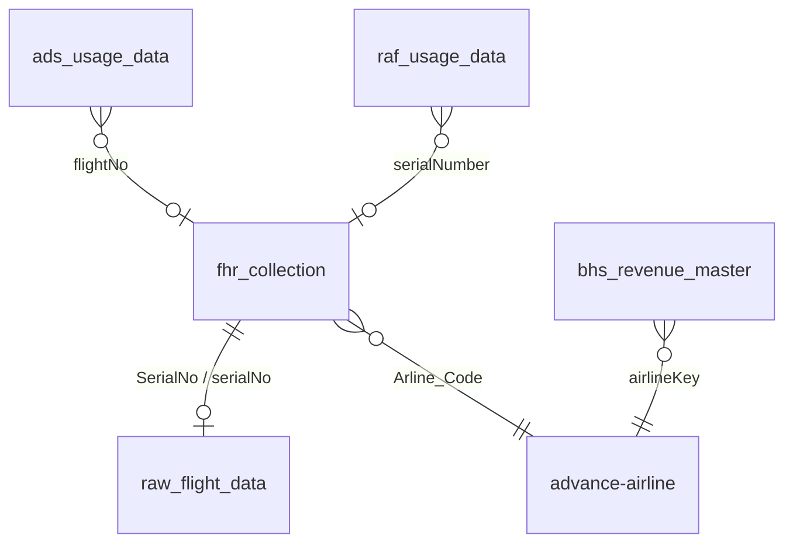
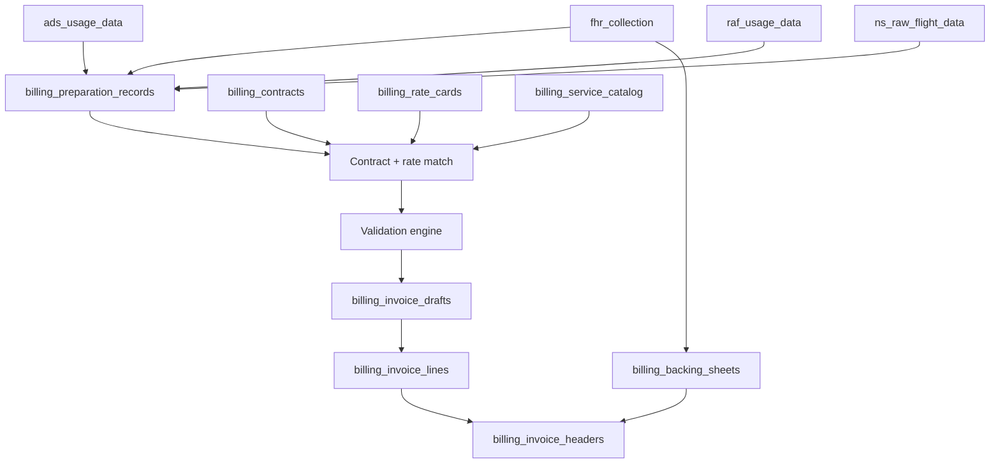

# Repository Analysis — FRIS Billing Foundation

**Purpose:** Document existing FRIS architecture patterns the native billing module must follow.

**Analysis date:** 2026-06-25

---

## Frontend architecture

### Routing

| Pattern | Location | Convention |
|---------|----------|------------|
| App Router | `client/app/**` | Thin page files delegate to feature screens |
| FRIS shell | `client/app/fris/layout.tsx` | `FrisRouteGuard` → `Navbar` → `FrisPermissionGuard` |
| Feature screens | `client/features/fris/*` | Large orchestrators (e.g. `AdvanceScreen.tsx`) |
| Query-param tabs | `/fris/advance?tab=invoicing` | In-page navigation, not nested routes |
| Dynamic import | Page wrappers | `dynamic(..., { ssr: false })` + `Suspense` |
| API proxy | `client/app/api-backend/[[...path]]/route.ts` | All backend traffic; Workers-safe cookie/encoding handling |

**Billing routing plan:** New top-level `/billing/*` routes under `client/app/billing/` with dedicated `billing/layout.tsx` mirroring FRIS guard patterns.

### Components

| Layer | Path | Usage |
|-------|------|-------|
| Domain UI | `client/components/fris/` | Advance, flights, reports, others |
| Primitives | `client/components/ui/` | shadcn/ui: button, dialog, DatePicker, ResponsiveTable |
| Layout | `client/components/fris/layout/` | Navbar, section nav grids |
| Advance invoicing | `client/components/fris/advance/invoicing/` | Filter bar, table, export footer |

**Conventions:**
- Card shells: `rounded-xl border border-gray-200 bg-white shadow-sm`
- Primary accent: emerald (`emerald-500/600`)
- Section nav: `FrisSectionNavGrid`, `FrisSectionNavMobileMenu`
- Wide data tables: custom `<table>` with sticky headers, horizontal scroll
- Column defs in separate `*-columns.ts` files

### Tables

| Pattern | Example | Notes |
|---------|---------|-------|
| Custom wide table | `InvoicingScheduledFlightDataTable.tsx` | 49+ columns, row select, select-all |
| ResponsiveTable | Admin pages | Desktop table + mobile cards |
| Excel export | exceljs + file-saver | Invoicing Excel currently stub |

### Forms

- Controlled `useState` objects (not react-hook-form in Advance)
- `AdminRadioDropdown`, `DatePicker`, `DateRangePicker`
- Local validation + `toast.error` (Sonner)
- Filter bar → fetch → table → dialog CRUD (Gateway pattern)

### State management

| Mechanism | Scope |
|-----------|-------|
| React Query | Dashboard, Admin only — **not** invoicing |
| Local useState | Advance/invoicing panels |
| localStorage | `userFlags`, `userRole`, station session |
| Context | Advance cargo, dashboard theme |

**Billing recommendation:** Introduce React Query for billing list pages (large datasets, cache invalidation on post/export).

---

## Backend architecture

### Module structure

68 NestJS modules under `server/src/`. Billing will add `server/src/billing/` as a feature module tree imported from `app.module.ts`.

### Controllers

**Reference:** `advance-invoicing.controller.ts`, `advance-airline.controller.ts`

```typescript
@Controller('billing/customers')
@FrisPagePermission('billing', 'Customers')  // new tab
export class BillingCustomersController {
  @Get()
  @Roles(...OPERATIONAL_ROLES)  // or finance-specific role bundle
  list(@CurrentStation() station: StationScopeContext, @Query() query: ListCustomersDto) {
    return this.service.list(station, query);
  }
}
```

**Patterns:**
- `@FrisPagePermission(tab, pageLabel)` for FRIS sub-page access
- `@Roles(...)` on mutations; read may use broader roles
- `@CurrentStation()` on every data endpoint
- `ValidationPipe` with `whitelist: true` on DTOs
- Response shape: `{ success: true, data: { ... } }` (invoicing style)

### Services

**Reference:** `advance-invoicing.service.ts`, `raw-flight-data.service.ts`

- Accept `StationScopeContext` as parameter
- Use `StationScope.filter()`, `stampCreate()`, `assertOwnership()`
- Pure mappers in `utils/` (see `invoicing-flight-report.mapper.ts`)
- Import shared modules: `FhrCollectionModule`, `RawFlightDataModule`

### DTOs

- `class-validator` decorators
- Separate query vs create/update DTOs
- Date formats: `yyyy-MM-dd` or `dd/MM/yyyy` (invoicing convention)

### Validation

- DTO-level: class-validator
- Business rules: dedicated validation service (delay, XXLD, ceiling, duplicate)
- Station scope enforced in service layer

### Guards

| Guard | Purpose |
|-------|---------|
| `GlobalJwtAuthGuard` | Default deny |
| `RolesGuard` | Role check when `@Roles()` present |
| `FrisPagePermissionGuard` | Employee sub-page flags |
| `OperationalThrottlerGuard` | EXPORT category on export paths |

### Roles

| Constant | Roles |
|----------|-------|
| `ADMIN_ROLES` | superadmin, admin |
| `OPERATIONAL_ROLES` | superadmin, admin, operations |
| `FRIS_PANEL_ROLES` | superadmin, manager, employee |

**Billing roles (proposed):** Add `finance` role or use `OPERATIONAL_ROLES` + `@FrisPagePermission('billing', ...)` for fine-grained access.

---

## Mongo architecture

### Existing collections (billing-relevant)

| Collection | Docs (est.) | Server schema | Station-aware | Billing role |
|------------|-------------|---------------|---------------|--------------|
| `fhr_collection` | large | Yes | Yes (`stationCode`) | Primary ops source — backing sheet |
| `raw_flight_data` | large | Yes | Yes | Schedule row, `exportedNAV` flag |
| `ads_usage_data` | ~33k | **No** | `station` field | Equipment/ADS lines |
| `ads_metadata_rows` | ~28k | **No** | `station` | ADS export metadata |
| `raf_usage_data` | ~328 | **No** | `station` | RAF lines |
| `bhs_revenue_master` | ~18 | **No** | `stationKey` | Contract/rate seed |
| `advance-airline` | ~49 | Yes | Yes | Customer master (ops) |
| `advance-raf-airline` | small | Yes | Yes | RAF airline config |
| `advance_schedule_setup` | ~24 | Yes | Yes | Schedule template |
| `ns_raw_flight_data` | — | Yes | Yes | Non-scheduled flights |

### Relationships



### Indexes (existing / needed)

| Collection | Index | Purpose |
|------------|-------|---------|
| `fhr_collection` | `SerialNo`, `stationCode` | Primary lookup |
| `raw_flight_data` | `data.Serial No`, `stationCode` | Daily pipeline |
| `ads_usage_data` | `flightNo`, `dateKey`, `station`, `state` | Billing source queries |
| `raf_usage_data` | `serialNumber`, `stdDateKey`, `station` | RAF billing |

New `billing_*` collections require compound indexes on `stationCode + customerCode + billingPeriod` — see `DATABASE_DESIGN.md`.

### Station access model

**Type:** `StationScopeContext { crossStation: boolean; stationCode?: string }`

| User type | Behaviour |
|-----------|-----------|
| Global admin + active station | Confined to station |
| Global admin, no station | `crossStation: true` |
| Non-global, no station | Fail-closed |
| Employee | Per-station `stationPermissions` flags |

**Billing collections** must use `stationAwarePlugin` and `@CurrentStation()` on all endpoints — same as `fhr_collection`.

**Gap:** `ads_usage_data`, `raf_usage_data`, `bhs_revenue_master` are not in station-aware plugin registry today.

---

## Existing billing-relevant data

### FHR (`fhr_collection`)

| Embed | Billing fields |
|-------|----------------|
| `mainDetails` | Airline, Arline_Code, TypeCraft, ATD/ATA, delays, aircraftBody, Route, Regn, MTOW |
| `terminalDetails` | STA/STD dates/times, FlightNo |
| `rampDetails1` | ULD/cargo/mail counts |
| `equipmentManpower` | fromTime, toTime, usageTime, exportedInNav |
| `remarks` | GH/airline rep remarks |

**Mapper:** `invoicing-flight-report.mapper.ts` → 49-column backing row.

### Flight number

- `mainDetails.ArrivalFltNo` / `DepartureFltNo` → `flightNoEquipmentNo`
- `terminalDetails.FlightNo`
- `ads_usage_data.flightNo`, `raf_usage_data.flightNo`

### Airline / Customer

- `advance-airline.code` / `.name`
- `mainDetails.Arline_Code` / `Airline`
- `customerCode` on usage rows

### Station

- `fhr_collection.stationCode`
- `raw_flight_data.stationCode`
- `ads_usage_data.station`, `raf_usage_data.station`

### Equipment

- FHR `equipmentManpower` embed
- `ads_usage_data` (serviceCode, equipment, times, rates)
- `equipmentDetails[]` on FHR

### Cleaning

- FHR ramp cleaning timestamps
- Advance schedule flags (deep/night/exterior)
- Export type: `Scheduled - Equipment - Cabin Cleaning`

### RAF

- `raf_usage_data` full rated rows
- `advance-raf-airline` master
- Export types: `RAF - Equipment - *`, `RAF - Manpower - *`

### ADS

- `ads_usage_data` batch imports
- `ads_metadata_rows` export tracking

### MAAS

- Pax shift forms (`PaxShiftFlightHandlingForm` MAAS field)
- No dedicated Mongo collection — extract from PSR collections

### XXLD

- Cancelled FHR / `flight_cancellations`
- Finance `Addl & XXLD Flt` rules (Excel)
- FRIS invoicing XXLD sections (UI shells)

### How operational data becomes invoice data



---

## Reporting architecture

| Pattern | Module | Billing reuse |
|---------|--------|---------------|
| Aggregation from FHR | `ReportsModule` | Backing, delay analytics |
| Materialized summaries | `dashboard-summary` | Billing dashboard KPIs |
| Excel export | Client exceljs | Invoice/backing export |
| PDF generation | `fhrReportPdf.ts` | Typography reference for invoice PDF |

**Billing reports** should follow `ReportsController` patterns: `@Roles(REPORT_VIEW_ROLES)`, station filter, paginated GET.

---

## API client patterns

| File | Role |
|------|------|
| `client/lib/api.ts` | `getApiBase()`, `frisFetch`, monolithic helpers |
| `client/lib/invoicing-api.ts` | Domain-specific invoicing endpoints |
| `client/lib/fris-auth-fetch.ts` | `credentials: 'include'` for JWT cookie |

**Billing client:** `client/lib/billing-api.ts` with typed endpoints per resource.

---

## Permission gating

| Layer | Component | Billing application |
|-------|-----------|---------------------|
| Auth | `FrisRouteGuard` | Billing layout guard |
| Nav | `Navbar` + `filterNavItemByFlags` | New "Billing" nav item |
| Route | `FrisPermissionGuard` | `/billing/*` permission rules |
| Sub-page | `@FrisPagePermission` | Per billing page flags |
| Admin config | `permission-tab-config.ts` | Add `billing` tab with sub-pages |

---

## Existing invoice-related functionality

| Feature | Location | Status |
|---------|----------|--------|
| Scheduled flight data grid | Advance → Invoicing | **Partial** — flight-report mode only |
| Export to NAV | PATCH navision-export | **Exists** — flag only |
| 49-column mapper | `invoicing-flight-report.mapper.ts` | **Exists** |
| Invoice Pending | `/others/invoice-pending` | **Partial** |
| Export errors | navision-export-errors API | **Partial** |
| Exported Data Log | Others UI | **Exists** |
| Service code catalog | `exported-data-log-type-options.ts` | **Exists** (140+ codes) |
| Contract data | `bhs_revenue_master` in Mongo | **Data only** — no API |
| RAF/ADS/Cleaning/MAAS/XXLD | Invoicing UI shells | **Missing** APIs |
| Posted invoices, PDF, credit memos | — | **Missing** |

---

## Deployment constraints

Production frontend runs on **Cloudflare Workers** via OpenNext. All billing API calls must go through `app/api-backend/[[...path]]/route.ts` — never add `next.config.ts` rewrite to Railway.

See `.cursor/rules/cloudflare-workers-deploy.mdc`.

---

## Key file reference

| Concern | Path |
|---------|------|
| Invoicing service | `server/src/advance-invoicing/advance-invoicing.service.ts` |
| Flight mapper | `server/src/advance-invoicing/utils/invoicing-flight-report.mapper.ts` |
| NAV export | `server/src/raw-flight-data/raw-flight-data.service.ts` |
| FHR schema | `server/src/fhr-collection/schema/fhr-collection.schema.ts` |
| Advance invoicing UI | `client/components/fris/advance/invoicing/` |
| Permission config | `client/lib/permission-tab-config.ts` |
| Station scope | `server/src/common/station/station-scope.ts` |
| Architecture docs | `docs/architecture/` |
