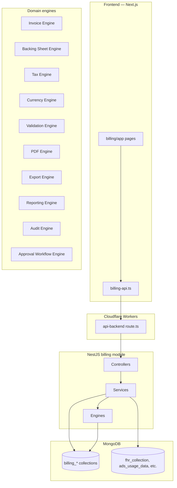
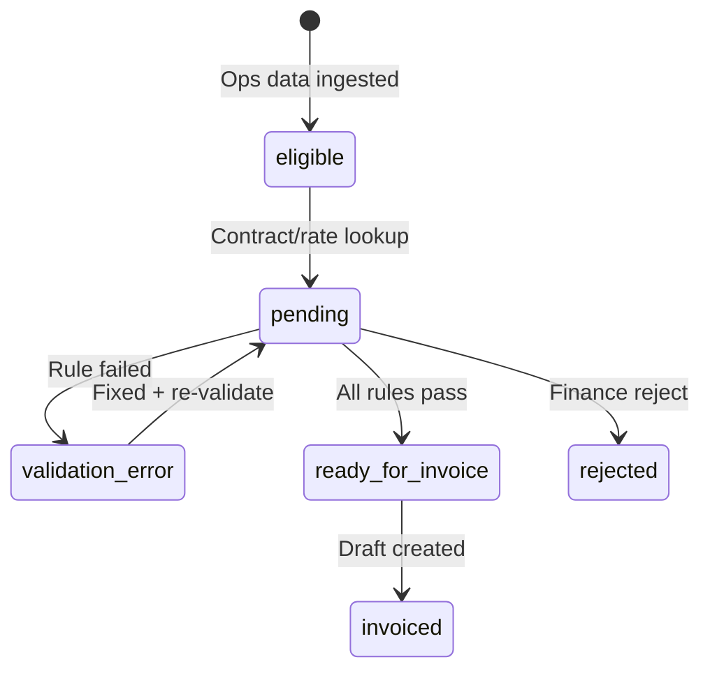

# Billing System Architecture

**Purpose:** Module design for FRIS native billing replacing Business Central invoicing.

**Module root:** `billing/` (docs + future `server/src/billing/`, `client/app/billing/`)

---

## Architecture diagram



---

## Module catalog

### 1. Dashboard

| Attribute | Value |
|-----------|-------|
| **Route** | `/billing/dashboard` |
| **Purpose** | KPI overview: pending preparation, drafts awaiting approval, posted this month, validation errors, export queue |
| **Services** | `BillingDashboardService` |
| **Collections** | Aggregates from `billing_preparation_records`, `billing_invoice_headers`, `billing_invoice_drafts` |
| **BC equivalent** | Role center invoicing cues |

### 2. Customer Management

| Route | `/billing/customers`, `/billing/customers/:id` |
| Services | `BillingCustomersService` |
| Collections | `billing_customers` (+ read `advance-airline`) |
| BC | Customers list + card |

### 3. Contract Management

| Route | `/billing/contracts`, `/billing/contracts/:id` |
| Services | `BillingContractsService`, `BillingContractVersionsService` |
| Collections | `billing_contracts`, `billing_contract_versions` |
| BC | Contract / handling pages |
| Features | Version history, XXLD/delay clause storage, validity periods |

### 4. Rate Card Management

| Route | `/billing/rate-cards` |
| Services | `BillingRateCardsService` |
| Collections | `billing_rate_cards` |
| BC | Tariff / rate / CR ceiling |
| Features | Category-based rates, ceiling caps, min billable units |

### 5. Service Catalog

| Route | `/billing/service-catalog` |
| Services | `BillingServiceCatalogService` |
| Collections | `billing_service_catalog` |
| BC | Items |
| Seed | 140+ EXPORT_LOG_TYPE_LABELS |

### 6. Billing Preparation

| Route | `/billing/preparation` |
| Services | `BillingPreparationService` |
| Collections | `billing_preparation_records` |
| BC | FRIS/NAV staging + finance reconciliation |
| **Critical:** Most important operational module — see §Preparation workspace |

### 7. Invoice Drafts

| Route | `/billing/invoice-drafts` |
| Services | `BillingInvoiceDraftsService` |
| Collections | `billing_invoice_drafts`, `billing_invoice_lines` |
| BC | Sales Invoices (unposted) |

### 8. Invoice Review

| Route | `/billing/review` |
| Services | `BillingReviewService` |
| Checks | Missing contract, missing rate, currency error, tax error, duplicate billing, approval status |
| BC | Finance review before Post |

### 9. Invoice Engine

| Service | `InvoiceEngineService` |
| Purpose | Line composition from preparation records + contract rates |
| Inputs | preparation records, rate cards, service catalog, tax rules, exchange rates |
| Outputs | invoice draft lines with calculated amounts |
| Rules | Basic handling qty from Reco_Skd equivalent, equipment minutes, delay %, XXLD decisions |

### 10. Invoice Management

| Route | `/billing/invoices`, `/billing/invoices/:id` |
| Services | `BillingInvoicesService` |
| Collections | `billing_invoice_headers`, `billing_invoice_lines` |
| BC | Sales Invoices + Posted Sales Invoices |
| Statuses | draft, pending_approval, approved, generated, posted, cancelled, archived |

### 11. Credit Memo Management

| Route | `/billing/credit-memos` |
| Services | `BillingCreditMemosService` |
| Collections | `billing_credit_memos` |
| BC | Sales Credit Memos + Posted |
| Triggers | XXLD not chargeable, delay dispute, invoice correction |

### 12. Backing Sheet Engine

| Service | `BackingSheetEngineService` |
| Route | `/billing/backing-sheets` |
| Collections | `billing_backing_sheets` |
| BC | Invoice attachment / 49-column appendix |
| Input | `fhr_collection` via `invoicing-flight-report.mapper.ts` |
| Output | Per-serial rows grouped by invoice |

### 13. Tax Engine

| Service | `TaxEngineService` |
| Route | `/billing/settings/taxes` |
| Collections | `billing_tax_rules` |
| BC | GST posting setup |
| Rules | CGST/SGST intra-state, IGST inter-state, line GST % |

### 14. Currency Engine

| Service | `CurrencyEngineService` |
| Route | `/billing/settings/currency` |
| Collections | `billing_exchange_rates` |
| BC | Currencies + Currency Exchange Rates |
| Rules | ROE by posting date, currency factor validation |

### 15. PDF Engine

| Service | `PdfEngineService` |
| Outputs | Invoice PDF, backing sheet PDF, customer billing summary, monthly summary, tax summary |
| BC | Sales - Invoice report |
| Reference | `fhrReportPdf.ts` typography; tabular backing at smaller font |
| Storage | R2/S3 via `FileStorageModule` |

### 16. Export Engine

| Service | `ExportEngineService` |
| Collections | `billing_exports` |
| Outputs | PDF download, Excel reconciliation pack, AR export |
| BC | Print/Email on posted invoice |

### 17. Reporting Engine

| Service | `ReportingEngineService` |
| Route | `/billing/reports` |
| Collections | `billing_reports` |
| Reports | Rev_Summary, Reco_Skd, Delay Flt, Addl & XXLD, tax summary, monthly summary, AR aging |
| BC | Customer Trial Balance, Aged AR |

### 18. Audit Engine

| Service | `AuditEngineService` |
| Route | `/billing/audit` |
| Collections | `billing_audit_logs` |
| Tracks | created, updated, approved, rejected, generated, posted, exported, downloaded |
| BC | Change log equivalent |

### 19. Approval Workflow Engine

| Service | `ApprovalWorkflowService` |
| Collections | `billing_approvals` |
| BC | Release / Request Approval |
| Flow | draft → pending_approval → approved → generated → posted |

---

## Operational billing source modules

Each page shows: Operational Data, Billing Eligibility, Contract Match, Rate Match, Validation Status.

| Route | Source collections | Service |
|-------|-------------------|---------|
| `/billing/scheduled-flights` | `fhr_collection`, `raw_flight_data` | `BillingSourcesScheduledService` |
| `/billing/cleaning` | `fhr_collection` (cleaning times) | `BillingSourcesCleaningService` |
| `/billing/raf` | `raf_usage_data` | `BillingSourcesRafService` |
| `/billing/maas` | PSR collections | `BillingSourcesMaasService` |
| `/billing/ads` | `ads_usage_data` | `BillingSourcesAdsService` |
| `/billing/xxld-scheduled` | `fhr_collection`, cancellations | `BillingSourcesXxldService` |
| `/billing/xxld-non-scheduled` | `ns_raw_flight_data` | `BillingSourcesXxldService` |
| `/billing/equipment` | `ads_usage_data`, FHR embed | `BillingSourcesEquipmentService` |
| `/billing/manpower` | FHR embed, ADS | `BillingSourcesManpowerService` |

All source modules write to `billing_preparation_records` via `BillingPreparationService.ingest()`.

---

## Preparation workspace (critical)

**Route:** `/billing/preparation`

| Tab | Status filter | User action |
|-----|---------------|-------------|
| Eligible | `eligible` | Review ops-complete rows |
| Pending | `pending` | Awaiting contract/rate match |
| Validation Errors | `validation_error` | Fix and re-validate |
| Rejected | `rejected` | Finance rejected |
| Ready For Invoice | `ready_for_invoice` | Bulk create invoice drafts |



---

## Validation engine

Central service invoked by preparation and review modules.

| Rule category | Rules |
|---------------|-------|
| Flight readiness | ATD present (or fallback policy), not cancelled, serial valid |
| Contract | Active contract for customer + period |
| Rate | Rate card match for service + category |
| Equipment | Min billable minutes, service code exists |
| Delay | ATA>STA, ATD>STD tiers, intimation waiver |
| XXLD | Clause, intimation, Conclusion/Resulted |
| Reconciliation | Flight count vs schedule |
| Ceiling | Rate cap by category |
| GST | Tax rule match |
| Currency | ROE exists for posting date |
| Duplicate | No duplicate serial billing in period |

---

## Server module structure

```
server/src/billing/
├── billing.module.ts
├── controllers/
│   ├── billing-dashboard.controller.ts
│   ├── billing-customers.controller.ts
│   ├── billing-contracts.controller.ts
│   ├── billing-rate-cards.controller.ts
│   ├── billing-service-catalog.controller.ts
│   ├── billing-preparation.controller.ts
│   ├── billing-sources.controller.ts
│   ├── billing-invoice-drafts.controller.ts
│   ├── billing-review.controller.ts
│   ├── billing-invoices.controller.ts
│   ├── billing-credit-memos.controller.ts
│   ├── billing-backing-sheets.controller.ts
│   ├── billing-reports.controller.ts
│   ├── billing-settings.controller.ts
│   └── billing-audit.controller.ts
├── services/
│   ├── (per controller)
│   └── engines/
│       ├── invoice-engine.service.ts
│       ├── backing-sheet-engine.service.ts
│       ├── tax-engine.service.ts
│       ├── currency-engine.service.ts
│       ├── validation-engine.service.ts
│       ├── pdf-engine.service.ts
│       ├── export-engine.service.ts
│       ├── reporting-engine.service.ts
│       ├── audit-engine.service.ts
│       └── approval-workflow.service.ts
├── schemas/
│   └── (Mongoose schemas per collection)
├── dto/
│   └── (per endpoint)
└── utils/
    ├── invoicing-flight-report.mapper.ts (reuse from advance-invoicing)
    └── reconciliation.mapper.ts
```

---

## Client module structure

```
client/app/billing/
├── layout.tsx              # BillingRouteGuard + BillingNav
├── dashboard/page.tsx
├── customers/
├── service-catalog/
├── contracts/
├── rate-cards/
├── settings/
│   ├── taxes/
│   ├── currency/
│   └── sequences/
├── scheduled-flights/
├── cleaning/
├── raf/
├── maas/
├── ads/
├── xxld-scheduled/
├── xxld-non-scheduled/
├── equipment/
├── manpower/
├── preparation/
├── invoice-drafts/
├── review/
├── invoices/
│   └── [id]/
├── credit-memos/
├── backing-sheets/
├── reports/
└── audit/

client/components/billing/
client/features/billing/
client/lib/billing-api.ts
```

---

## Cross-cutting concerns

| Concern | Implementation |
|---------|----------------|
| Auth | JWT + `@FrisPagePermission('billing', pageLabel)` |
| Station | `@CurrentStation()` + `StationScope` on all queries |
| Audit | `AuditEngineService` hook on every mutation |
| Sequences | Atomic `findOneAndUpdate` on `billing_sequences` |
| File storage | `FileStorageModule` for PDFs |
| Protection | EXPORT throttle on PDF/export endpoints |
| Workers | All API via `api-backend` route — no direct Railway fetch from browser |

---

## Integration with existing FRIS

| Existing | Integration |
|----------|-------------|
| `advance-invoicing` | Wrap scheduled-flight API during transition; deprecate |
| `raw-flight-data` navision-export | Parallel `exportedNAV` flag until cutover |
| `advance-airline` | Read-only master; sync to `billing_customers` |
| `fhr_collection` | Read for backing + preparation ingest |
| `invoicing-flight-report.mapper.ts` | Reuse in backing sheet engine |
| Others invoice-pending | Redirect to `/billing/preparation` |

---

## Non-goals (phase 1)

- Full G/L ledger replacement (AR balance on invoice header sufficient initially)
- Sales Orders / Quotes / Shipments
- Bank payment reconciliation
- Real-time BC sync (optional future connector)
